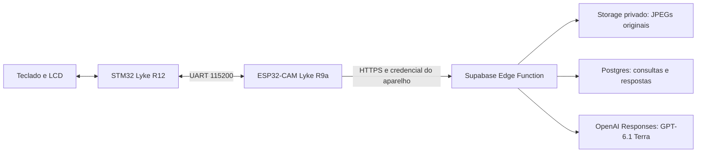

# CAMERA_ESP — calculadora Lyke

Firmware, API e esquema da calculadora com **STM32G431CBU6 + ESP32-CAM clássica AI Thinker**.
[Repositório público no GitHub](https://github.com/daniSoares08/camera-esp-lyke).

**Concluído em 26/11/2026: STM R14 + ESP R12 finais instalados** por Wi-Fi/UART,
com 49 teclas, configurações e última resposta preservadas. Sono em SHIFT+AC
e despertar somente por MODE confirmados pelo usuário e pelo retorno do ESP.

Sono automático após **60 minutos sem botão**, configurável de **1 a 1440 min**
em MODE > MODO CIENTIFICO > SONO. Tentativas Wi-Fi param após **20 minutos
continuamente desconectado**; conectado não é interrompido. 32 verificações
nativas aprovadas; ensaio real cronometrado dispensado pelo proprietário.
[Validação, funcionamento e limites](docs/REVISAO-R14-TEMPORIZADORES.md).

Manual final **edição 4.0, 36 páginas**, em PDF e Markdown. API v4 publicada;
somente OpenAI integrada/testada. Consumo e temperatura ainda não medidos.

## Começar

[Guia da revisão R14/R12](docs/REVISAO-R14-TEMPORIZADORES.md), com operação,
validação e limites. A API v4 mantém texto e desenhos opcionais. O manual 4.0
explica uso, energia, Wi-Fi, fotos, configuração da API e atualização.

- [Estado e continuidade](docs/conhecimento/ESTADO-E-RETOMADA.md)
- [Manual ilustrado do comprador em PDF](docs/manual/Manual-Lyke.pdf)
- [Manual completo em Markdown para leitura e uso com IA](docs/manual/Manual-Lyke.md)
- [Esquema elétrico HTML offline](outputs/ligacoes/ESP-CAM-esquema.html) — baixe o arquivo e abra no navegador.
- [Hardware, alimentação e GND/R](docs/conhecimento/HARDWARE.md)
- [Firmware da Lyke e operação](firmware/lyke_stm32/LEIA-ME.md)
- [API, fotos e implantação](docs/API-E-ARQUIVO.md)
- [Mapa das 49 teclas](docs/conhecimento/teclado-lyke.csv)

## Uso

Ligue a calculadora. O ESP abre `Calc-Lyke` e tenta a última rede externa salva.
SHIFT + REPLAY direita captura uma foto; até três podem formar uma consulta.
No menu MODE, envie as fotos à IA. A resposta aparece no leitor do LCD e no portal
local `http://192.168.8.1`. O celular também pode abrir as fotos e iniciar a resolução.

O modelo principal é **GPT-6.1 Terra**, com raciocínio alto, conferência das contas,
texto ASCII e linhas de até 21 caracteres. O modo econômico usa GPT-6 Luna.
O catálogo consultado oferece Terra como 6.1, não como 6.2.

Na R9a instalada, o Wi-Fi de atualização não expira. Na R10 preparada, o portal
abre no boot/menu e encerra após dois minutos sem atividade. Desligar pelo STM
continua disponível.
O leitor dedica sua janela ao texto e aos desenhos da resposta. Cima/baixo rolam
16 pixels; esquerda/direita movem 24 pixels em figura larga ou 48 verticais em texto.
Fora do leitor, o cabeçalho mantém bateria e três posições de fotos. O Wi-Fi pisca
três vezes ao conectar e desaparece; na falha alterna Wi-Fi/X.
A bateria usa quatro níveis aproximados:
`!` pisca em tensão baixa e `?` indica falha de leitura. Não é porcentagem exata.
As fotos são arquivadas quando enviadas para resolução; uma captura offline fica em RAM
e precisa ser enviada antes de desligar para entrar no arquivo da nuvem.

## Compilação

ESP no Windows: Arduino CLI, core ESP32 **3.3.6**, ArduinoJson **7.4.2**, Python e esptool.
As ferramentas locais ficam em `.tools/` e `.venv/`; elas não são publicadas neste repositório.
Crie `.private/ap-password.txt` com a senha WPA2 do portal (8–63 caracteres ASCII) e execute:

```powershell
.\.venv\Scripts\python.exe firmware/esp32cam_integrada/build.py --profile lyke --revision lyke-r12
```

STM32 no WSL, com GCC ARM e Newlib Nano:

```sh
sh firmware/lyke_stm32/build.sh lyke-r14
```

Teste da API sem consumir créditos, com Node **24**:

```sh
node --test supabase/tests/cloud.test.ts supabase/tests/graphics.test.ts
```

Os comandos compilam STM R14 + ESP R12 instalados; os limites de validação estão no guia da revisão.
Os testes nativos e a geração do manual estão documentados em
`firmware/lyke_stm32/BATERIA-R11.md` e `scripts/manual_lyke/README.md`.
A instalação inicial do carregador V2 exige USB uma vez; com a base instalada,
as próximas atualizações do STM usam `lyke-stm32-ota.bin` no portal do ESP.
O repositório contém fontes e documentação; binários reais ficam no ambiente local.

## Credenciais e cópia de publicação

Este repositório é uma cópia dos fontes preparada por `scripts/prepare_private_repo.py`.
Chaves OpenAI, tokens Supabase/GitHub, senhas Wi-Fi, fotos privadas, backups de flash/NVS
e binários reais ficam somente no workspace local e nos serviços apropriados.
Senhas de AP em fontes e documentos históricos foram substituídas por marcadores.
Os fontes antigos da montagem S3 podem exigir restaurar suas configurações locais próprias.
Nunca grave uma imagem da montagem S3 na ESP32-CAM clássica.

A chave OpenAI fica nos segredos da Edge Function. A calculadora guarda em NVS apenas
sua credencial de acesso ao serviço. O bucket de fotos é privado.

## Arquitetura



O arquivo também preserva fontes e notas da calculadora anterior S3 + DevKit.
Ela é uma montagem diferente e está identificada separadamente na base de conhecimento.
