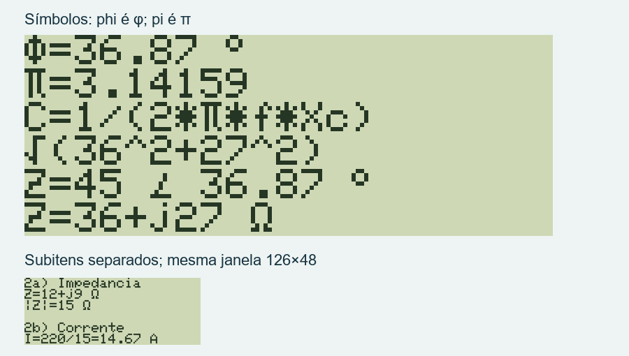

# ESP Lyke R10: energia e respostas

**Preparação sucedida por STM R13 + ESP R11**, que incorpora estes ajustes e
adiciona sono profundo: [guia atual](REVISAO-R13-SONO-PROFUNDO.md). Continua
sem gravação por bateria crítica; o restante registra a preparação anterior.

25/11/2026. **Preparada, não instalada.** Usuário pediu esperar a carga:
a bateria continua crítica. Hardware permanece STM R12 + ESP R9a.
Somente o ESP precisa da atualização; não confundir com o antigo STM R10.
API v4 publicada no serviço existente, sem mudança de banco, bucket ou segredos.

## Revisão das consultas

Foram recuperadas cinco consultas e onze fotos JPEG da sessão de 24/11,
19h51 a 21h24 (Brasília). Originais e respostas recebidas estão no workspace
em `output/privado/Fotos-testes-Lyke-24-11-2026.zip`, fora da publicação.
Há quatro questões distintas; a última foi reenviada com imagens mais legíveis.

As respostas repetiam dados e conferências, desenvolviam aritmética elementar
demais, calculavam grandezas não pedidas e inventavam `P(m,t)` para fasores.
Na questão das duas cargas, o ângulo total foi 29,47°, mas o recálculo dá
29,5102°. Potências, fator de potência e reatância principais conferem.
Na primeira tentativa da questão 4 faltavam dados; em vez de uma resposta
longa simbólica, a instrução agora pede informar exatamente o que falta.

`phi` significa φ, ângulo de defasagem; `pi` significa π, constante 3,14159…
A correção anterior de símbolos estava na calculadora local, enquanto o
leitor IA continuava ASCII. A R10 converte tokens completos em glifos no
renderizador: π, φ, θ, Ω, Δ, μ, grau, raiz e ângulo, sem alterar o protocolo
UART de pixels nem exigir nova gravação do STM. π e φ têm glifos distintos.

A API continua usando tokens ASCII compatíveis com clientes antigos. Os
blocos gráficos novos preservam linhas lógicas e um espaço entre subitens;
o ESP conta células de símbolos e faz a quebra uma única vez. O texto legado
continua com até 21 caracteres por linha. Fórmulas longas quebram em espaços
ou antes de operadores, preservando os números nos casos testados.

Nova orientação: fórmula, substituição, transformações relevantes e resultado,
com títulos curtos; menos repetição e conferências, sem entregar só gabarito.
Não cria `P(m,t)` nem calcula capacitância quando se pede apenas reatância.
Desenho apenas quando pedido ou necessário para compreender a resolução.
Respostas antigas não são reescritas nem cobradas novamente automaticamente.

Uma consulta real reutilizou a primeira foto: 33,1 s, resposta de 1.020
caracteres contra 1.666 antes (38,8% menor), seis subitens, separadores
preservados no documento e ângulo 29,51°. Esse teste ainda incluiu capacitância
extra; a instrução final foi reforçada depois para encerrar em Xc.
**Uma chamada paga de teste, sem captura nova.** Relatórios e fotos são privados.

## Política de energia autorizada

O usuário mudou a preferência anterior de portal permanente e priorizou autonomia.

- CPU a 80 MHz em repouso/leitura, 160 MHz na captura e no pedido HTTPS.
- Calc-Lyke abre no boot e pelo comando PORTAL do menu CONFIGURAR/ATUALIZAR.
  Fecha após 120 s sem requisições ao portal. Página aberta consulta status
  a cada quatro segundos e, portanto, mantém o portal; feche-a após configurar.
- Com portal fechado, apenas STA (cliente do roteador), com modem-sleep.
  OFF pelo STM continua desligando Wi-Fi até solicitação explícita/reinício.
- A captura suspende o rádio automaticamente, espera 80 ms, liga câmera e
  autofocus; só restaura a rede após desligar a câmera e esperar 30 ms.
  Todos os retornos de erro após a suspensão passam pela mesma restauração.
  A fila JPEG em PSRAM é preservada. Resolução, qualidade e autofocus mantidos.
- Foto pelo portal é agendada após responder HTTP 202, permitindo informar
  a pausa antes de desligar o rádio. A página aguarda e tenta atualizar a lista.
- Sem deep-sleep manual: é preciso preservar resposta/fotos em RAM e UART.
  Não foi habilitado auto light-sleep: o SDK pré-compilado usado não tem PM.
- Diagnóstico local inclui frequência da CPU, razão do último reset e estado
  da captura. A razão do reset é evidência auxiliar, não medição da alimentação.

O firmware anterior já desligava a câmera após fotografar; não havia vídeo
contínuo. O rádio AP+STA permanente, CPU, regulador da ESP32-CAM, boost e STM
contribuem para consumo/calor. O aquecimento por componente não foi medido.
Modem-sleep de estação não garante economia mantendo AP permanente nem elimina
picos de rádio. A pausa evita sobrepor câmera e rádio, mas ainda precisa de
teste físico. Não foi desabilitado detector de brownout nem proteção de bateria.

## Resistores e alimentação

Usuário confirmou **330 Ω entre +5 V e GND** para impedir desligamento automático
do conversor: 5/330 = 15,15 mA; 25/330 = 75,76 mW. Equivale a pelo menos
20,5 mA da bateria em 3,7 V, mais perdas do boost. Não remover sem identificar
o conversor e testar sua carga mínima; a função desse resistor continua necessária.

Divisor do STM: dois 470 kΩ conforme montagem corrigida. Em 3,84 V consome
3,84/940.000 = 4,09 µA (aproximadamente 4,47 µA em 4,2 V). É desprezível diante
do consumo ativo das placas. Não atribuir a ele autonomia de uma hora.
A etiqueta da bateria diz 2.000 mAh, mas capacidade efetiva, corrente e perdas
não foram medidas. Queda de tensão no pico é hipótese forte para os reinícios
relatados, não diagnóstico fechado. Se persistir com rádio pausado, medir
BAT+, 5 V e 3V3 sob captura e identificar boost/regulador/limites da bateria.

## Validação e aplicação

Compilação ESP32 clássica aprovada. Testes nativos do renderizador verificam
π/φ, limites de tokens, contagem por célula, separadores, números na quebra,
janela 126×48, desenhos/pan, checksum UART e temporização do portal inclusive
overflow. Dezessete testes da API aprovados e uma consulta real concluída.

Manifesto: `firmware/esp32cam_integrada/bin/lyke-r10/manifest.json`.
Pacote privado: `output/firmware/lyke-r12-esp-r10-preparado.zip`.
O relatório nativo geral é da base STM R12; `testes-esp.json` identifica a
validação focada desta revisão. Nenhum binário real vai para o GitHub.

Após carga suficiente e alimentação estável: reidentificar ESP clássico/4 MiB
e revisões no portal, preservar resposta/fotos, gravar só a aplicação ESP R10,
conferir digest, MAP49, resposta e redes salvas. Validar captura com Wi-Fi
habilitado, restauração automática, menu/portal e leitor no LCD. Medir calor,
corrente e autonomia depois; não há ganho percentual ou duração garantidos.

Fontes primárias:
[Espressif: energia do Wi-Fi](https://docs.espressif.com/projects/esp-idf/en/v5.5.2/esp32/api-guides/wifi.html#esp32-wi-fi-power-saving-mode),
[Espressif: modos de baixo consumo](https://docs.espressif.com/projects/esp-idf/en/stable/esp32/api-guides/low-power-mode/low-power-mode-wifi.html),
[Espressif: gerenciamento de energia](https://docs.espressif.com/projects/esp-idf/en/stable/esp32/api-reference/system/power_management.html).

