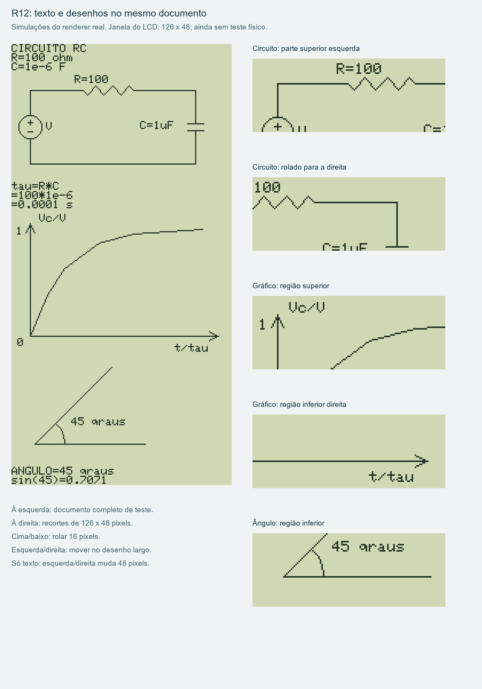

# Revisão instalada: STM R12 + ESP Lyke R9a

24/11/2026. **Instalados por Wi-Fi e UART existente**, após o usuário ligar
a calculadora e autorizar. Reinício, revisões e 49 teclas mapeadas conferidos.
Configurações e última resposta preservadas. API v3 publicada, compatível
com clientes antigos. Geração real de figuras ainda aguarda teste no aparelho.
Não confundir revisão do STM com a revisão independente do ESP.

## Rede da universidade

Verificados no Windows somente os perfis `Visitantes` e `VISITANTES`:
ambos têm autenticação aberta, sem criptografia/chave. Nenhuma senha foi
exibida ou exportada. O usuário confirmou internet direta, sem portal de login.
O firmware aceita rede aberta com senha em branco, então esse tipo de
segurança é compatível. O perfil salvo não comprova a frequência disponível.
No campus ainda precisa haver cobertura de **2,4 GHz**, faixa do ESP32 clássico.
Não foi realizada associação real à rede universitária nesta preparação.

Quando estiver no campus: abrir Calc-Lyke, procurar redes, escolher o SSID
exato (maiúsculas/minúsculas importam) e salvar/conectar com senha vazia.
Não substituir a senha do próprio Calc-Lyke por uma senha da universidade.
Referência: [datasheet Espressif ESP32](https://documentation.espressif.com/esp32_datasheet_en.html).

## Novo indicador Wi-Fi

- Sem conexão/tentativa: não ocupa o cabeçalho.
- Conexão concluída: sinal acende três vezes, 300 ms ligado/300 ms apagado;
  depois desaparece. Atualizações repetidas de status não reiniciam a animação.
- Tentativa falhou ou conexão foi perdida: alterna Wi-Fi e X a cada 500 ms.
- Novo sucesso ou desligamento pelo menu encerra o aviso de falha.
- Animação somente no cabeçalho normal; não sobrepõe o leitor da resposta.

O ESP informa LINK IDLE/JOIN/OK/FAIL/OFF, além do STATE antigo. O STM mantém
fallback para estados/notificações antigos. Conexão indica associação/IP;
não é uma garantia de acesso ao servidor quando uma rede bloqueia internet.

## Desenhos entre os passos da resposta

A API aceita a opção `display=lyke-graphics-v1`, usada pelo novo ESP.
O modelo retorna texto e figuras em JSON com schema estrito; continua
obrigado a mostrar fórmula, substituição, desenvolvimento e resultado.
As figuras não substituem as contas. Sem necessidade de desenho, pode
retornar só texto. São representações 2D monocromáticas, não fotografias.

Comandos: linha, retângulo, círculo, arco, texto, seta, resistor, capacitor
e fonte. Curvas são compostas de segmentos. Os comandos são validados;
não há código executável, imagens externas nem download de URLs do modelo.
O ESP transforma os comandos nos pixels da janela visível. Não é necessário
gastar a resposta da IA descrevendo cada bit de um desenho.

| Limite | Valor |
|---|---|
| Janela visível | 126×48 pixels, mesma área anterior |
| Figura | largura 126/192/256; altura 48..512 |
| Documento | até 32 blocos, seis figuras, 384 comandos totais |
| Comandos por figura | até 128 |
| Texto | até 12.000 caracteres LCD, sem eliminar desenvolvimento para caber |
| Display list JSON | até 28.000 caracteres |
| Buffer no STM | apenas 768 bytes de pixels por janela |

No leitor novo:

| Tecla | Ação |
|---|---|
| Cima/baixo | rola 16 pixels no documento |
| Esquerda/direita em figura larga | move horizontalmente 24 pixels |
| Esquerda/direita onde só há texto/figura estreita | recua/avança 48 pixels |
| AC ou MODE | retorna às contas |

Não há cabeçalho sobre a resposta. A largura da região visível determina
se esquerda/direita desloca a figura ou avança no texto. O ESP ajusta os
limites e devolve as coordenadas efetivas. O documento completo fica no ESP;
o STM recebe só um recorte, com sequência, máscara de linhas e checksum.
Uma janela incompleta/corrompida não é apresentada como válida.

Respostas antigas continuam legíveis. A API entrega também texto com descrição
das figuras para clientes antigos. No portal atual, Abrir última resposta
continua mostrando essa versão textual; as figuras são exibidas no LCD novo.
Documento gráfico salvo no ESP é vinculado por CRC32 ao texto, para não
associar figura antiga a uma resposta nova após interrupção da gravação.
O JSON bruto também fica em `answer_text` no arquivo privado do servidor,
enquanto `answer_lcd` mantém a representação textual. Sem migração de banco.

## Instalação concluída

1. Reidentificado ESP32 clássico com flash 4 MiB, ESP R8/STM R11 e 49 teclas.
2. Aplicação ESP R9 instalada por OTA, slot app1 e digest conferidos.
3. STM R12 instalado pelo mesmo portal/UART em 14,34 s, HTTP 200;
   CRC da aplicação, reinício, revisão R12 e mapa de 49 teclas conferidos.
4. A resposta salva tinha rodapé antigo de tokens. Correção R9a oculta
   somente esse rodapé no leitor novo, sem alterar o texto salvo.
5. ESP R9a instalado por OTA em app0; revisão/digest, configurações,
   resposta idêntica byte a byte e `keyboard_ready=true` conferidos.

Aplicação STM: 62.568 bytes, CRC32 `37e35397`. ESP R9a: 1.362.896 bytes.
Hashes completos nos manifestos/inventário. Relatórios locais privados:
`device-stm-r12-wifi.json` e `device-r9a-ota.json`, em `.private/lyke-cloud/`.

O loader V2 instalado continua idêntico. Não foi necessário USB,
alterar o mapa de flash nem acrescentar fios. Binário DFU é apenas para
instalação inicial/recuperação e não vai no formulário de OTA.

Para repetir: instalar primeiro a aplicação ESP R9a, conferir reinício,
e então `lyke-stm32-ota.bin` da R12 na linha STM32 do portal.
Conferência visual de animação, leitor e rolagem depende do aparelho;
revisão/MAP49 por si só não comprovam esses resultados físicos.

## Testes e limites de validação

Compilações ARM/ESP32 aprovadas. Testes nativos: três pulsos sem repetição,
falha/off/overflow do relógio, imagem completa/incompleta/corrompida, protocolo,
interface real e janela física, pan, texto legado, circuito RC, curva e ângulo.
Loader: 514 pontos de interrupção no exemplo + 209 amostras na aplicação.
Dezesseis testes locais da API aprovados, incluindo opt-in/schema, limites,
compatibilidade e cache, sem chamadas pagas. GET público confirma versão 3;
POST sem autenticação foi recusado com 401 antes de armazenamento/IA.

**Ainda não testados:** geração real de desenhos pelo modelo, renderização
física, UART real de janelas gráficas e conexão à universidade. Os desenhos
da prévia são exemplos determinísticos, não resultados do modelo ou fotos do LCD.
O modelo ainda pode errar geometria/conexões; a validação de formato não
prova correção matemática ou topológica.

Manual do comprador edição 3.0 em `docs/manual/`: R12/R9a, com instruções
e imagens do leitor gráfico e aviso Wi-Fi. As figuras são simulações locais.
