# Manual do comprador - Calculadora Lyke modificada

> Edição 3.0, 24/11/2026. STM32 R12 + ESP32-CAM R9a. Somente OpenAI testada. Claude ainda não integrado/testado.

Este Markdown contém o conteúdo integral do PDF, com as mesmas figuras. Mantenha `manual-assets/` junto deste arquivo para exibir imagens. O ZIP inclui a pasta.

## Índice

- [01. Sua calculadora, do primeiro toque à IA](#pagina-01)
- [02. Escolha o que você quer fazer](#pagina-02)
- [03. Conheça a calculadora](#pagina-03)
- [04. Primeiros minutos: conta e foto](#pagina-04)
- [05. Navegação, tela e atalhos](#pagina-05)
- [06. Contas comuns e correção](#pagina-06)
- [07. Ângulo e formato dos números](#pagina-07)
- [08. Potências, raízes e logaritmos](#pagina-08)
- [09. Trigonometria e coordenadas](#pagina-09)
- [10. Frações, porcentagem e graus](#pagina-10)
- [11. Memórias, constantes e aleatórios](#pagina-11)
- [12. Estatística e regressão](#pagina-12)
- [13. RPN: cálculo por pilha](#pagina-13)
- [14. Grave uma sequência de teclas](#pagina-14)
- [15. Entenda as duas conexões Wi-Fi](#pagina-15)
- [16. Cadastre sua rede de internet](#pagina-16)
- [17. Fotografe um enunciado legível](#pagina-17)
- [18. Veja, baixe ou descarte fotos](#pagina-18)
- [19. Envie à IA e leia a resposta](#pagina-19)
- [20. Onde suas fotos ficam guardadas](#pagina-20)
- [21. API: entenda antes de configurar](#pagina-21)
- [22. OpenAI: conta e crédito da API](#pagina-22)
- [23. OpenAI: crie e proteja a chave](#pagina-23)
- [24. Ative o serviço e faça o teste](#pagina-24)
- [25. Claude: prepare conta e cobrança](#pagina-25)
- [26. Claude: chave e o que falta ativar](#pagina-26)
- [27. Modelos, custos e uso econômico](#pagina-27)
- [28. Desligar, despertar e preservar dados](#pagina-28)
- [29. Atualize somente com o arquivo correto](#pagina-29)
- [30. Se algo não funcionar](#pagina-30)
- [31. Todos os itens do menu](#pagina-31)
- [32. Teclas: funções científicas](#pagina-32)
- [33. Teclas: edição, memória e controle](#pagina-33)
- [34. Aprenda com uma IA usando o .md](#pagina-34)
- [35. Compatibilidade e entrega da unidade](#pagina-35)
- [36. Fontes, imagens e versão](#pagina-36)

<a id="pagina-01"></a>

## 01. Sua calculadora, do primeiro toque à IA

*MANUAL DO COMPRADOR*

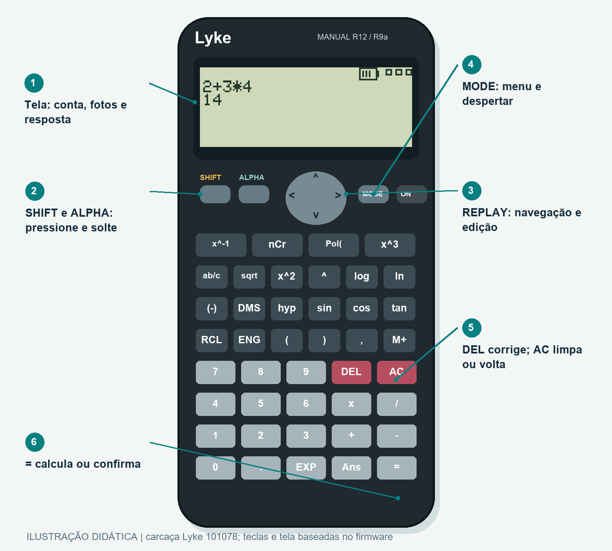

Ilustração didática da Lyke modificada. Não é fotografia da unidade montada.

Guia de uso da calculadora Lyke 101078 modificada, com cálculo científico offline, câmera, Wi-Fi, resolução por IA e arquivo privado de fotos.

> **Comece sem configurar nada**
>
> Para fazer contas, basta ligar o aparelho e usar o teclado. Para resolver fotos com IA, siga o início rápido e a conexão ao Wi-Fi.

Edição 3.0 - 24/11/2026. Compatibilidade: STM32 Lyke R12 + ESP32-CAM Lyke R9a. As telas deste guia são simulações baseadas no firmware.

**Integração testada: OpenAI, usada pelos modelos do ChatGPT.** Claude aparece como alternativa de preparação da conta; ainda não foi integrado nem testado nesta calculadora.


<a id="pagina-02"></a>

## 02. Escolha o que você quer fazer

*COMO USAR ESTE GUIA*

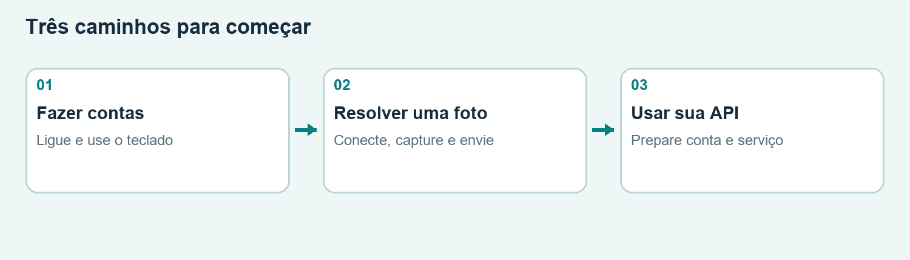

Fluxo ilustrativo. Os capítulos avançados podem ficar para depois.

| Quero... | Vá às páginas |
| --- | --- |
| Conhecer as teclas e ligar pela primeira vez | 3 a 6 |
| Usar as funções científicas, memórias e estatística | 7 a 14 |
| Conectar à internet e resolver questões fotografadas | 15 a 19 |
| Entender onde as fotos ficam guardadas | 20 |
| Configurar minha própria conta OpenAI | 21 a 24 |
| Preparar uma conta Claude e entender a limitação atual | 25 e 26 |
| Controlar gastos, Wi-Fi e atualização | 27 a 29 |
| Resolver problemas ou consultar todas as teclas | 30 a 33 |
| Aprender com IA e conferir compatibilidade e fontes | 34 a 36 |

### Como ler os passos

Uma sequência como **SHIFT, direita** significa: pressione SHIFT, solte e depois pressione a seta direita. Não é necessário segurar duas teclas. Nomes em maiúsculas reproduzem o visor. Os sinais x e / representam multiplicação e divisão.

> **Guarde os dados da sua unidade**
>
> O fornecedor deve entregar a senha de Calc-Lyke, o local da chave de energia, a orientação da câmera, o método de recarga e, se contratado, o acesso ao serviço de IA. Esses dados variam conforme a montagem.


<a id="pagina-03"></a>

## 03. Conheça a calculadora

*01 | O APARELHO*


Desenho da frente com funções das teclas. Posição da câmera, chave e conector depende da montagem.

O teclado e a carcaça vêm da Lyke 101078, mas o funcionamento é definido pelo firmware deste projeto. Legendas secundárias impressas na carcaça podem diferir das funções descritas aqui.

| Parte | Para que serve |
| --- | --- |
| Tela | Mostra expressão, resultado, menus e respostas em páginas. |
| REPLAY | As quatro setas movem o cursor ou percorrem listas e respostas. |
| MODE / = / AC | Abrem o menu / confirmam / voltam ou limpam. |
| SHIFT / ALPHA | Ativam a função secundária ou uma variável para a próxima tecla. |
| Câmera e Wi-Fi | Capturam questões e acessam o serviço de IA pela internet. |

> **Como ligar**
>
> Use a chave física de alimentação indicada pelo fornecedor. A tecla ON está sem função nesta versão de 49 teclas. Não é necessário abrir a calculadora nem ligar fios para o uso normal.


<a id="pagina-04"></a>

## 04. Primeiros minutos: conta e foto

*02 | INÍCIO RÁPIDO*

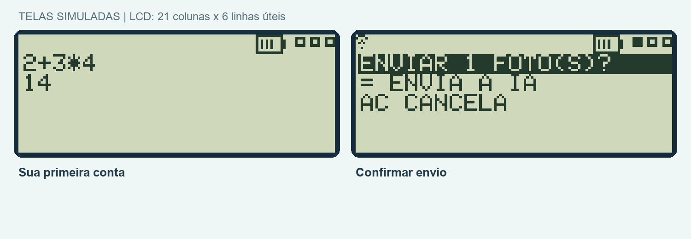

Simulações. A conta local funciona sem internet; a resolução por IA exige o serviço configurado.

### Faça a primeira conta

1. Ligue pela chave física. Se a tela apenas foi apagada por SHIFT, AC, pressione MODE para despertar.
2. Pressione AC. Digite 2 + 3 x 4 e depois =. O resultado esperado é 14.
3. Para uma nova conta, digite um número. Para continuar usando o resultado, pressione um operador.

### Resolva a primeira questão com foto

1. Conecte a calculadora a uma rede de internet 2,4 GHz pelo portal do celular: páginas 15 e 16. O fornecedor precisa ter configurado o serviço de IA.
2. Na tela de contas, aponte a câmera ao enunciado. Pressione SHIFT, direita. Aguarde a captura terminar e um quadradinho ficar cheio.
3. Abra MODE, selecione ENVIAR FOTOS IA com as setas e pressione =. Confirme com = novamente.
4. Aguarde a IA. Para consultar, use MODE > ULTIMA RESPOSTA > =. Avance com direita/baixo; volte com esquerda/cima. AC retorna às contas.

> **Antes de desligar**
>
> Envie ou baixe as fotos que deseja guardar. As capturas ainda na fila ficam somente na memória temporária e se perdem ao cortar a energia.


<a id="pagina-05"></a>

## 05. Navegação, tela e atalhos

*03 | CONTROLES*

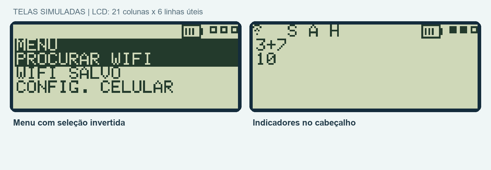

Simulações: o cabeçalho pode mostrar Wi-Fi, S, A, H e até três fotos.

| Ação | Como fazer |
| --- | --- |
| Abrir / fechar o menu | MODE abre. AC ou MODE volta à calculadora. |
| Escolher uma opção | Setas percorrem a lista; = abre ou confirma. |
| Capturar rapidamente | Na tela de contas: SHIFT, direita. |
| Apagar a entrada atual | AC. Isso não remove as fotos. |
| Apagar a tela e desligar o Wi-Fi | SHIFT, AC. MODE desperta a tela; não corta a energia. |
| Zerar memórias locais | SHIFT, MODE. Limpa também estatística, pilha, histórico e Ans. |

### Entenda os pequenos sinais

A bateria à esquerda das fotos mostra de zero a quatro barras. ! pisca quando está baixa; ? indica falha na medição. **S**: SHIFT está armado; **A**: ALPHA; **H**: função hiperbólica. Os três quadrados representam fotos: vazios sem captura, preenchidos após a captura, com indicação piscante durante a operação. Ao conectar à rede externa, o sinal Wi-Fi pisca três vezes e desaparece. Na falha, alterna Wi-Fi e X até reconectar ou desligar o Wi-Fi. Calc-Lyke disponível não significa internet conectada.

> **SHIFT, AC não é desligamento elétrico**
>
> Essa combinação apaga a tela e manda o ESP desligar o Wi-Fi. Para desligar todo o aparelho, use a chave física. Ao reiniciar o ESP, Calc-Lyke volta a ficar disponível.


<a id="pagina-06"></a>

## 06. Contas comuns e correção

*04 | CÁLCULO OFFLINE*

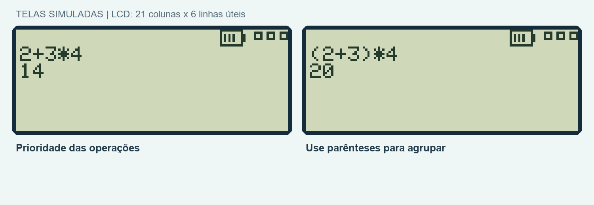

Simulações do modo algébrico. Use ponto para decimais e x para multiplicar.

1. Digite a expressão usando números, +, -, x, / e parênteses. Use multiplicação explícita: 2 x (3 + 4).
2. Pressione = para calcular. Multiplicação e divisão têm prioridade sobre soma e subtração. Parênteses mudam a ordem.
3. Durante a edição, esquerda/direita move o cursor. DEL apaga o elemento anterior; uma função como sin( é apagada como um elemento.
4. Para rever contas, use cima/baixo no REPLAY. Há até oito expressões no histórico temporário. Depois de um resultado, DEL ou esquerda/direita recupera a expressão para editar.
5. SHIFT, DEL alterna inserir e sobrescrever. AC limpa a entrada para começar novamente.

### Continuar com o resultado

Após 14, pressione x 2 = para obter 28. O firmware usa Ans para continuar a conta. Para usar o resultado em outra posição, pressione a tecla Ans. Digitar um algarismo após um resultado inicia uma expressão nova.

| Exemplo digitado | Resultado |
| --- | --- |
| 1 . 5 + 2 . 2 5 = | 3.75 |
| ( (-) 2 ) ^ 2 = | 4 |
| (-) 2 ^ 2 = | -4: o sinal fica fora da potência |

> **Limites de entrada**
>
> A expressão comporta até 95 elementos internos; funções contam como um elemento. Se aparecer EXPRESSAO CHEIA, divida o cálculo. Se faltar um fechamento, use ) antes de =.


<a id="pagina-07"></a>

## 07. Ângulo e formato dos números

*05 | PREFERÊNCIAS*

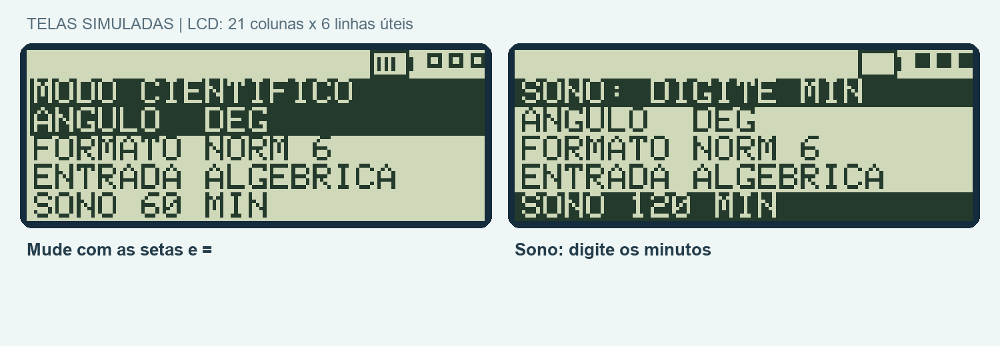

Simulações do menu MODO CIENTIFICO. Saia com AC ou MODE para salvar.

1. Abra MODE > MODO CIENTIFICO > =. Use cima/baixo para escolher ANGULO, FORMATO ou ENTRADA.
2. Na linha ANGULO, esquerda/direita ou = alterna DEG, RAD e GRA. DEG usa graus; RAD usa radianos; GRA usa grados (400 em uma volta).
3. Na linha FORMATO, alterne NORM, FIX, SCI e ENG. Ainda nessa linha, pressione um número de 0 a 9 para ajustar a precisão.
4. Na linha ENTRADA, escolha ALGEBRICA para o uso comum ou RPN para pilha. Saia com AC ou MODE para gravar as preferências.

| Formato | O que muda |
| --- | --- |
| NORM | Exibição geral: decimal ou científica conforme a ordem de grandeza. |
| FIX 2, por exemplo | Mostra duas casas decimais, quando o valor cabe nesse formato. |
| SCI 2, por exemplo | Notação científica com duas casas na mantissa: 1.23E+4. |
| ENG | Expoente múltiplo de 3: 12.345E+3. A tecla ENG alterna ENG/NORM. |

O atalho SHIFT, Ans alterna o ângulo. Para garantir que essa mudança sobreviva a um desligamento, entre em MODO CIENTIFICO e saia salvando. O formato arredonda a apresentação; não transforma a calculadora em um sistema de precisão exata.


<a id="pagina-08"></a>

## 08. Potências, raízes e logaritmos

*06 | FUNÇÕES CIENTÍFICAS*

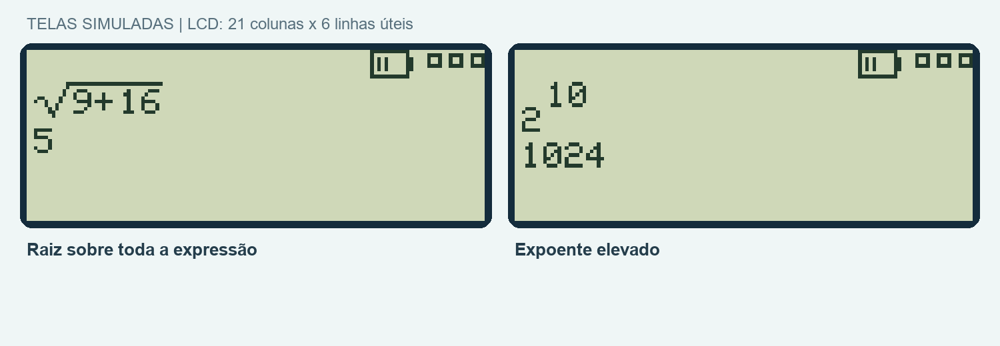

Telas do código do LCD: raiz desenhada com barra e expoente elevado. Feche o argumento com ) antes de calcular.

| Função | Sequência de exemplo | Resultado |
| --- | --- | --- |
| Quadrado / cubo | 5, x^2, = / 2, x^3, = | 25 / 8 |
| Potência / recíproco | 2, ^, 5, = / 4, x^-1, = | 32 / 0.25 |
| Raiz quadrada | sqrt, 8, 1, ), = | 9 |
| Raiz cúbica | SHIFT, x^3, 2, 7, ), = | 3 |
| Raiz de índice n | 3, SHIFT, ^, 2, 7, = | 3: raiz cúbica de 27 |
| Logaritmo decimal | log, 1, 0, 0, ), = | 2 |
| Logaritmo natural | ln, ALPHA, ln, ), = | 1: ln(e) |
| Potências 10^x e e^x | SHIFT, log / SHIFT, ln | Digite o argumento e feche ) |
| Fatorial | 5, SHIFT, x^-1, = | 120 |

### Números grandes e pequenos

EXP insere o expoente de base 10. Digite **6 . 0 2 EXP 2 3 =** para 6.02 x 10^23. Para 1.2 x 10^-3, use 1 . 2 EXP (-) 3 =. EXP não significa e elevado a x; essa função é SHIFT, ln.

> **Quando houver erro de domínio**
>
> Raiz quadrada de número negativo e ln de zero/negativo não dão resultados reais. O fatorial aceita inteiros de 0 a 170. Esta calculadora local trabalha com números reais, não com álgebra simbólica ou números complexos.


<a id="pagina-09"></a>

## 09. Trigonometria e coordenadas

*07 | FUNÇÕES CIENTÍFICAS*

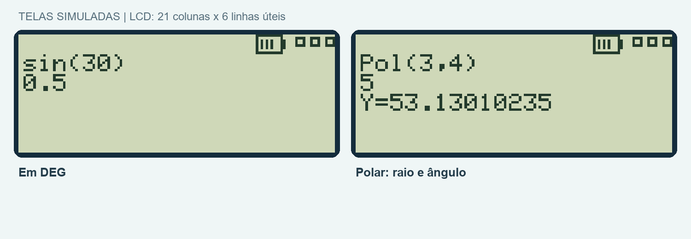

Simulações. Em Pol, a segunda linha de resultado mostra o ângulo; em Rec, mostra y.

1. Escolha o ângulo em MODE > MODO CIENTIFICO. Para sin(30) = 0.5, use DEG.
2. Pressione sin, cos ou tan, digite o argumento, feche ) e pressione =. Para arco-seno, arco-cosseno ou arco-tangente, use SHIFT antes da função.
3. Para sinh, cosh ou tanh, pressione hyp e depois a função. Para a inversa hiperbólica, a ordem é hyp, SHIFT, sin/cos/tan. O H desaparece quando a função é inserida.

| Conversão | Digite | Leia |
| --- | --- | --- |
| Cartesiana para polar | Pol( 3 , 4 ) = | Resultado: r=5. Linha Y: ângulo=53.1301... em DEG. |
| Polar para cartesiana | SHIFT, Pol( 5 , 53.13010235 ) = | Resultado: x aproximadamente 3. Linha Y: y aproximadamente 4. |

Pol(x,y) calcula raio e ângulo; Rec(r,ângulo) faz a conversão inversa. Os dois valores ficam também nas variáveis X e Y. Nas funções hiperbólicas, o argumento é um número real; o modo DEG/RAD não muda sinh, cosh ou tanh.

> **Verifique o modo angular**
>
> Se o resultado parecer estranho, confira DEG/RAD/GRA antes de refazer a conta. tan(90) em DEG é indefinida; arco-seno e arco-cosseno reais exigem argumento entre -1 e 1.


<a id="pagina-10"></a>

## 10. Frações, porcentagem e graus

*08 | FORMATOS E COMBINAÇÕES*

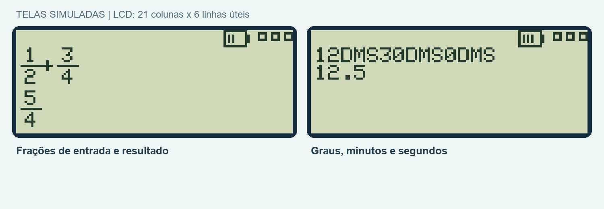

Simulações; DMS representa a tecla com os símbolos de graus, minutos e segundos.

| O que fazer | Como usar |
| --- | --- |
| Digitar uma fração | 1, ab/c, 3 funciona como 1/3. Use parênteses em numeradores compostos. |
| Mostrar o resultado em fração | Depois de =, pressione ab/c. Pressione novamente para voltar. SHIFT, ab/c também alterna a apresentação. |
| Porcentagem | SHIFT, = insere %; depois = calcula. % significa dividir o valor anterior por 100. |
| Entrada DMS | 12, DMS, 30, DMS, 0, DMS, = resulta em 12.5 graus. |
| Saída DMS | Após calcular 12.5, pressione DMS: aparece 12:30:00. DMS novamente retorna ao decimal. |
| Combinações e arranjos | 5, nCr, 2, = dá 10. 5, SHIFT, nCr, 2, = dá 20. |

### Porcentagem sem surpresa

Para calcular 10% de 200: **200 x 10, SHIFT, =, =** resulta em 20. Para acrescentar 10%: **200 x (1 + 10, SHIFT, =, ), =** resulta em 220. A expressão 200 + 10% resulta em 200.1; não há acréscimo comercial automático.

> **A fração é uma forma de exibir o número**
>
> O resultado é calculado numericamente. A exibição tenta encontrar uma fração com denominador até 9999; nem todo decimal aparecerá como fração. Em nCr/nPr, use n e r inteiros, com 0 <= r <= n; há limites de faixa.


<a id="pagina-11"></a>

## 11. Memórias, constantes e aleatórios

*09 | REUTILIZE VALORES*

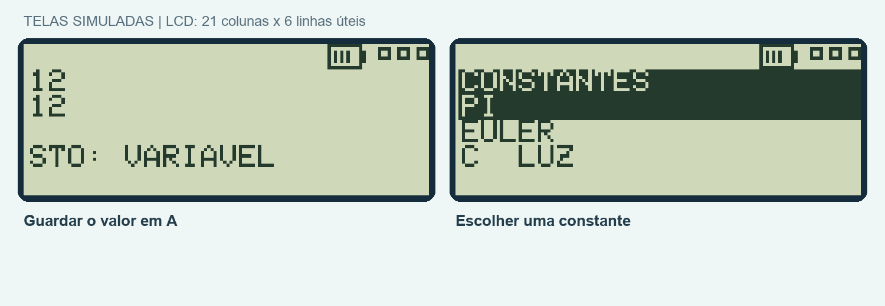

Simulações. RCL recupera; SHIFT, RCL prepara o armazenamento na variável escolhida.

1. Para guardar 12 em A: digite 12, pressione SHIFT, RCL e depois a tecla (-), associada a A.
2. Para recuperar A: pressione RCL, (-), =. Para usar A numa expressão, pressione ALPHA, (-).
3. M+ soma o valor atual à memória M. SHIFT, M+ subtrai. Para ler M, use RCL, M+, =.

| Variável | Tecla depois de ALPHA, RCL ou STO |
| --- | --- |
| A / B / C | (-) / DMS / hyp |
| D / E / F | sin / cos / tan |
| X / Y / M | ) / , / M+ |
| Δ / θ / Ω | ^ / log / EXP |

MODE > CONSTANTES oferece pi, Euler e, velocidade da luz c=299792458 m/s, gravidade padrão g0=9.80665 m/s^2, Avogadro NA=6.02214076E23 mol^-1 e Boltzmann kB=1.380649E-23 J/K. Selecione e pressione = para inserir. A legenda G GRAVIDADE significa g0, não a constante gravitacional universal G.

SHIFT, EXP insere pi; ALPHA, ln insere e. SHIFT, ponto insere Ran#: valores pseudoaleatórios de 0.000 a 0.999. SHIFT, 0 insere Rnd(, que arredonda para cerca de dez algarismos significativos.

> **Zerar tem efeitos amplos**
>
> SHIFT, MODE limpa as variáveis, Ans, estatística, histórico e pilha RPN. Essas memórias também se perdem ao cortar a energia. A sequência gravada de programa e as preferências salvas são preservadas.


<a id="pagina-12"></a>

## 12. Estatística e regressão

*10 | ANÁLISE DE DADOS*

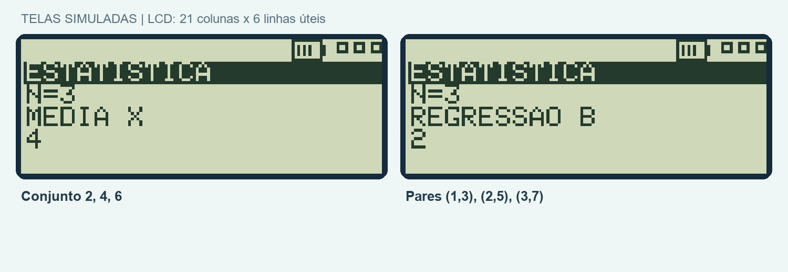

Simulações. A estatística usa uma coleção temporária até zerar memórias ou desligar.

1. Antes de um conjunto novo, use SHIFT, MODE. Atenção: isso também limpa as outras memórias locais.
2. Para os valores 2, 4 e 6: digite 2 e pressione SHIFT, vírgula. AC volta à conta. Repita com 4 e depois 6. Não é necessário pressionar = antes de registrar.
3. Entre em MODE > ESTATISTICA. Percorra as métricas com as setas. Para esse conjunto: N=3, média=4, desvio amostral=2, desvio populacional aproximadamente 1.63299, soma=12 e soma dos quadrados=56.
4. Para regressão, reinicie a coleção e registre pares: 1, vírgula, 3, SHIFT, vírgula; AC; depois (2,5) e (3,7) da mesma forma. A vírgula sem SHIFT separa x e y.

Métricas disponíveis: MEDIA X, MEDIA Y, DESVIO X AMOSTRA, DESVIO X POP., SOMA X, SOMA X^2, REGRESSAO A, REGRESSAO B, CORRELACAO R e SOMA XY. A reta é **y = A + B*x**. Nos três pares acima, A=1, B=2 e R=1.

Nas seis primeiras métricas, = copia um valor válido para Ans e retorna à conta. SHIFT, 1 abre SOMA X; SHIFT, 2 abre MEDIA X. A regressão e a correlação são consultadas na tela, sem esse atalho de cópia.

> **Se aparecer SEM DADOS**
>
> Pode faltar amostra ou variação: desvio amostral precisa de pelo menos dois valores; regressão precisa de variação em x. Não misture valores simples e pares na mesma coleção. Não há remoção individual exposta no teclado nesta revisão.


<a id="pagina-13"></a>

## 13. RPN: cálculo por pilha

*11 | USO OPCIONAL*

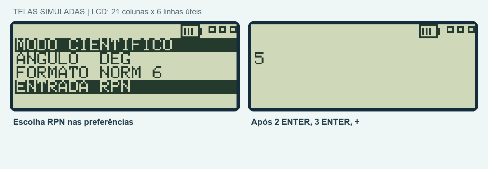

Simulações. No modo RPN, a tecla = atua como ENTER para empilhar.

Se você está começando, mantenha ENTRADA ALGEBRICA. RPN é uma alternativa para quem prefere informar os valores antes do operador. A pilha guarda até 16 valores.

1. Abra MODE > MODO CIENTIFICO, escolha ENTRADA RPN e saia com AC para salvar.
2. Para 2+3: digite 2, =, 3, =, +. O topo passa a ser 5.
3. Para (2+3)x4, continue: 4, =, x. O resultado será 20.
4. Para subtração e divisão, a ordem importa: 10, =, 2, =, / dá 5. O segundo valor fica no topo; o operador usa o valor anterior como primeiro operando.
5. Funções de um valor, como x^2, atuam no topo. Com a entrada vazia, DEL remove o topo. SHIFT, MODE zera a pilha e as demais memórias locais.

| Mensagem | O que significa |
| --- | --- |
| PILHA INSUFICIENTE | O operador precisa de mais valores. Empilhe-os com =. |
| PILHA CHEIA | Há 16 valores. Use operações ou DEL para liberar espaço. |
| Voltar ao modo comum | MODO CIENTIFICO > ENTRADA ALGEBRICA; AC salva. |

> **Observe qual modo está selecionado**
>
> O cabeçalho não mostra um indicador permanente ALG/RPN. Se = e os operadores parecerem agir de outra forma, confira ENTRADA em MODO CIENTIFICO.


<a id="pagina-14"></a>

## 14. Grave uma sequência de teclas

*12 | PROGRAMA*

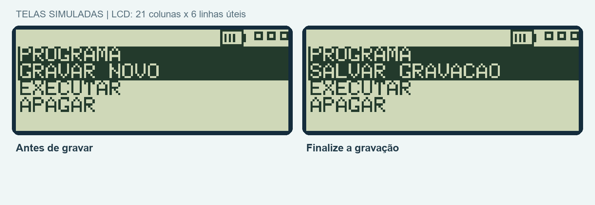

Simulações. Há um programa salvo de até 96 teclas; ele é uma repetição de teclas, sem condições ou laços.

1. Abra MODE > PROGRAMA > GRAVAR NOVO > =. A entrada é limpa e a calculadora passa a registrar as teclas.
2. Faça um exemplo simples: 2 + 3 =. A indicação GRAVANDO PROGRAMA identifica a gravação.
3. Para terminar, pressione MODE, entre em PROGRAMA e escolha SALVAR GRAVACAO. Pressione =.
4. Para repetir, abra PROGRAMA > EXECUTAR > =. A sequência salva é reproduzida e o exemplo resulta em 5.
5. Para excluir a sequência, escolha PROGRAMA > APAGAR > =. Para substituí-la, grave uma nova e salve.

A sequência salva permanece após desligar, assim como as preferências científicas. Ao atingir o limite de gravação, o firmware encerra e salva. Use sequências de cálculo simples e confira o resultado antes de depender delas.

> **O programa não automatiza a câmera ou a internet**
>
> Atalhos de captura e apagamento de tela não são reproduzidos como ações de rede pelo programa. Esta função não é uma linguagem de programação: ela repete teclas do cálculo local.


<a id="pagina-15"></a>

## 15. Entenda as duas conexões Wi-Fi

*13 | INTERNET E CELULAR*

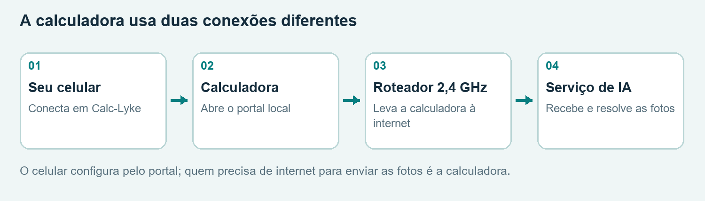

Diagrama conceitual. Calc-Lyke é uma rede local de configuração, não um plano de internet.

| Conexão | Finalidade |
| --- | --- |
| Celular > Calc-Lyke | Abrir o painel em http://192.168.8.1, configurar e baixar fotos. |
| Calculadora > roteador ou hotspot | Acessar o servidor e a OpenAI. Use Wi-Fi 2,4 GHz. |
| Ícone no LCD | Indica que a calculadora está conectada à rede externa. |

1. Ligue a calculadora. Em R9a, Calc-Lyke abre automaticamente ao iniciar o ESP e fica disponível até você desligar o Wi-Fi pelo menu.
2. No celular, abra Ajustes/Configurações > Wi-Fi, escolha Calc-Lyke e informe a senha entregue pelo fornecedor.
3. Se aparecer Sem internet, escolha permanecer conectado. Abra o navegador e digite exatamente http://192.168.8.1, incluindo http://.
4. Se o celular sair dessa rede sozinho, desative temporariamente a troca automática para dados móveis ou outra rede. Tente novamente.

> **Hotspot do celular**
>
> Para usar o mesmo celular como roteador e configurador, siga as possibilidades do sistema dele. É mais simples fazer o primeiro cadastro com outro celular/computador conectado a Calc-Lyke, enquanto o primeiro fornece o hotspot 2,4 GHz.


<a id="pagina-16"></a>

## 16. Cadastre sua rede de internet

*14 | PORTAL DO CELULAR*

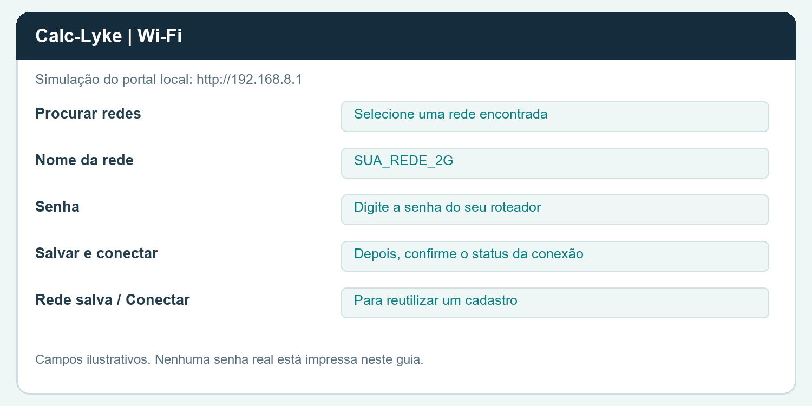

Simulação da seção Wi-Fi. A aparência pode variar conforme o navegador.

1. Com o portal aberto, na seção Wi-Fi toque em Procurar redes. Aguarde a lista e selecione a sua rede. Confira Nome da rede.
2. Digite a senha do roteador e toque em Salvar e conectar. Aguarde a confirmação de rede externa conectada. A senha do roteador é diferente da senha de Calc-Lyke.
3. Para uma rede já cadastrada, escolha Rede salva e toque em Conectar. No teclado, o equivalente é MODE > WIFI SALVO > selecionar a rede > =.
4. Para procurar pelo teclado, use MODE > PROCURAR WIFI. A lista mostra redes encontradas; escolher uma abre a orientação para configurar no celular. A senha é cadastrada no portal.
5. Depois de uma conexão bem-sucedida, o ESP tenta a última rede usada ao reiniciar. Se a senha mudar, faça o cadastro novamente pelo portal.

> **A rede não aparece?**
>
> Confira se ela oferece 2,4 GHz. A ESP32 clássica não se conecta ao Wi-Fi de 5 GHz. Redes com página de login, como hotéis e escolas, podem exigir configuração adicional que este portal não oferece.


<a id="pagina-17"></a>

## 17. Fotografe um enunciado legível

*15 | CÂMERA*

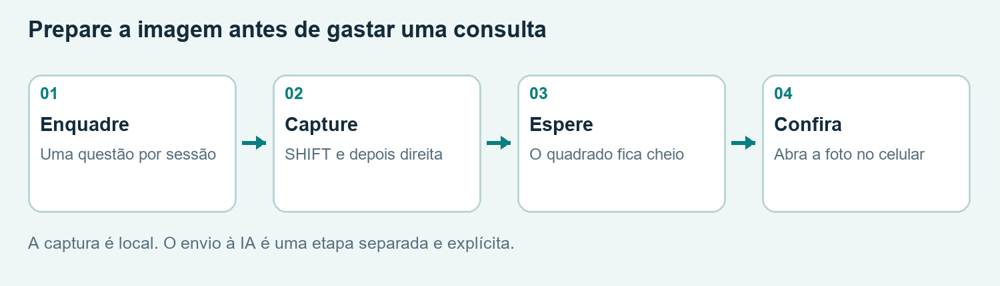

Fluxo ilustrativo. A orientação da lente depende da montagem fornecida.

1. Ilumine a folha sem reflexo e limpe a lente com cuidado. Posicione a calculadora para que a câmera veja o enunciado completo, incluindo unidades, tabelas e figura.
2. Na tela de cálculo, pressione SHIFT e depois direita. Também pode usar MODE > TIRAR FOTO > = ou Tirar foto no portal.
3. Aguarde CAPTURANDO FOTO terminar. Um quadradinho preenchido indica uma foto guardada. Não repita a tecla enquanto ESP OCUPADO aparecer.
4. Se precisar, capture uma segunda e uma terceira foto. Use-as como partes da mesma questão: enunciado, figura e detalhes. Não há obrigação de usar três.
5. Confira as imagens em VER FOTOS NO WIFI. Remova uma captura ruim antes de enviar. Evite texto muito pequeno, movimento, sombra e página cortada.

### Ajustes pelo celular

Na seção Fotos do portal, Espelhar e Inverter na vertical corrigem a orientação; Autofoco habilita o recurso do módulo compatível. Toque em Salvar câmera e refaça a captura para avaliar. Não há prévia de vídeo ao vivo no uso normal; a câmera é acionada para a foto e depois pausada.

> **Capacidade e duração**
>
> São até três JPEGs na fila, com limite de 512 KiB por foto e 1,5 MiB no conjunto. Elas ficam na RAM: desligar ou reiniciar apaga as fotos ainda não enviadas.


<a id="pagina-18"></a>

## 18. Veja, baixe ou descarte fotos

*16 | GALERIA LOCAL*

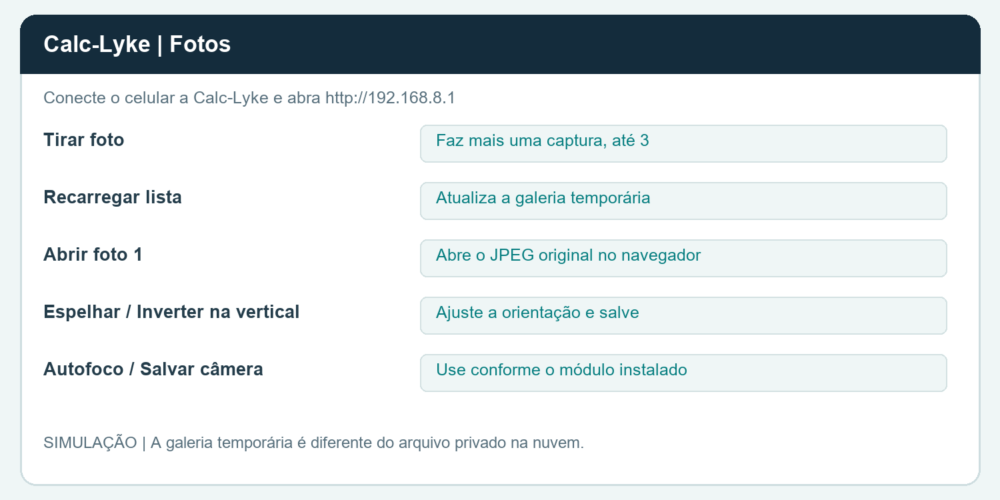

Simulação da seção Fotos. As imagens reais são abertas pelos links da galeria.

1. No teclado, selecione MODE > VER FOTOS NO WIFI > =. Conecte o celular a Calc-Lyke e abra o endereço mostrado.
2. Na seção Fotos, toque em Recarregar lista e em Abrir foto 1, 2 ou 3. Amplie para conferir se o texto pode ser lido.
3. Para salvar uma cópia no celular, use o comando do navegador para baixar/salvar a imagem. O nome e a posição do comando variam entre Android e iPhone.
4. Para apagar só a captura mais recente da fila, use MODE > REMOVER ULT. FOTO > =. Para descartar a fila toda, use MODE > LIMPAR FOTOS > =. Essas ações não são uma lixeira recuperável.
5. Depois de uma resolução bem-sucedida, a fila local é esvaziada. As fotos enviadas ficam no arquivo privado do serviço; veja a página 20.

> **Sem internet ainda é possível baixar**
>
> A visualização local funciona pela rede Calc-Lyke sem crédito de API e sem internet externa. Baixar antes de desligar é a forma mais simples de guardar uma foto que você não quer enviar à IA.


<a id="pagina-19"></a>

## 19. Envie à IA e leia a resposta

*17 | RESOLUÇÃO*

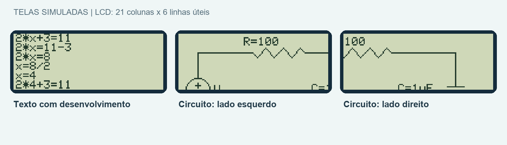

Simulações do renderizador: texto e dois recortes de um circuito largo. Não são desenhos gerados pelo modelo em um teste físico.

1. Confira conexão externa, serviço de IA e uma a três fotos da mesma questão. Abra MODE > ENVIAR FOTOS IA > =.
2. Leia a quantidade e confirme com =. AC cancela antes de enviar. A tela indica AGUARDANDO IA; mantenha a energia e aguarde.
3. Abra MODE > ULTIMA RESPOSTA > =. Cima/baixo rolam 16 pixels. Em figura larga, esquerda/direita movem 24 pixels para os lados; em texto ou figura estreita, recuam/avançam 48 pixels. AC ou MODE retorna ao cálculo.
4. A última resposta fica salva no ESP. No portal, Abrir última resposta mostra texto e descrições das figuras; os desenhos aparecem no LCD.

A janela continua com 126x48 pixels, sem cabeçalho ou ícones. Texto e desenhos 2D de circuitos, gráficos ou ângulos podem aparecer entre os passos. O serviço exige fórmula, substituição, desenvolvimento e resultado; a figura não substitui as contas. No texto, x^2 é quadrado, sqrt(...) é raiz e * é multiplicação.

> **Se a IA pedir outra foto**
>
> Confira se faltou parte do enunciado ou se a imagem ficou ilegível. Remova/refaça a captura e envie novamente. Compare a transcrição dos dados com o papel: a IA pode errar leitura, unidade ou cálculo. Uma nova consulta pode gerar custo.


<a id="pagina-20"></a>

## 20. Onde suas fotos ficam guardadas

*18 | ARQUIVO E PRIVACIDADE*

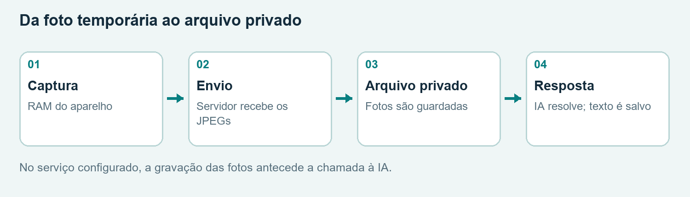

Fluxo do serviço testado. Não há galeria pública nem compartilhamento automático de links.

| Situação | O que fica disponível |
| --- | --- |
| Capturou, mas não enviou | Só a fila temporária. Baixe pelo portal antes de desligar. |
| Envio chegou ao arquivo | JPEGs no bucket privado lyke-images. Uma falha antes dessa etapa pode impedir o arquivo. |
| IA respondeu com sucesso | Fotos e resposta no serviço; última resposta também no ESP. A fila local é limpa. |
| IA falhou depois do arquivo | As fotos já gravadas permanecem na nuvem. A fila local é mantida para nova tentativa. |
| REMOVER ou LIMPAR no menu | Descarta a fila do ESP. Não apaga o histórico do servidor. |

### Como obter as cópias

1. Para imagens ainda na fila, baixe pela galeria local no celular.
2. Se você administra seu próprio projeto Supabase: entre no projeto, abra Storage > lyke-images, localize a pasta do dispositivo e da consulta e baixe os JPEGs. A tabela lyke_requests registra a consulta e os caminhos.
3. Se contratou o serviço do fornecedor, solicite acesso, exportação ou exclusão a ele. O portal atual não oferece uma galeria completa de consultas antigas nem exclusão do arquivo da nuvem.

Private significa acesso controlado, não ausência de processamento: as imagens são enviadas ao servidor e ao provedor de IA para resolução. Prefira fotografar apenas o exercício, sem rostos, documentos ou dados pessoais desnecessários. [S8]


<a id="pagina-21"></a>

## 21. API: entenda antes de configurar

*19 | CONTA E SERVIÇO*

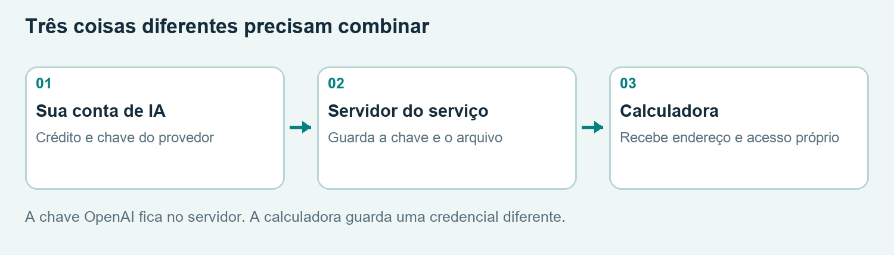

Diagrama de configuração. Uma conta logada no ChatGPT, sozinha, não configura a calculadora.

| Nome | Onde vai |
| --- | --- |
| Chave da API OpenAI | Segredo OPENAI_API_KEY no servidor do seu serviço. |
| Endereço do serviço | Campo Endereço do serviço no portal Calc-Lyke. |
| Chave de acesso da calculadora | Campo com esse nome no portal; emitida pelo serviço para o aparelho. |

### Escolha seu caminho

**Serviço já entregue pelo fornecedor:** você usa o endereço e a credencial recebidos. Não precisa criar um Supabase nem pagar a API diretamente, salvo o combinado na compra. Pule para a conexão da página 24.

**Quero usar minha própria conta OpenAI:** crie a conta e a chave nas páginas seguintes. Você ou o fornecedor também precisa administrar uma instância do servidor compatível. Criar a chave e comprar crédito não substitui essa instalação.

> **ChatGPT e API são produtos com cobrança própria**
>
> Estar logado no ChatGPT não cria uma chave de API. Confira a organização e o saldo na plataforma de API. Eventuais benefícios de créditos vinculados a planos exigem as condições e a vinculação oferecidas pela plataforma. [S1, S2]

O serviço desta edição usa OpenAI Responses e armazenamento privado no Supabase. Não existe seletor de provedor no portal R9a. Não cole uma chave sk-... ou sk-ant-... no campo de acesso da calculadora.


<a id="pagina-22"></a>

## 22. OpenAI: conta e crédito da API

*20 | PASSO A PASSO OPENAI - 1/3*

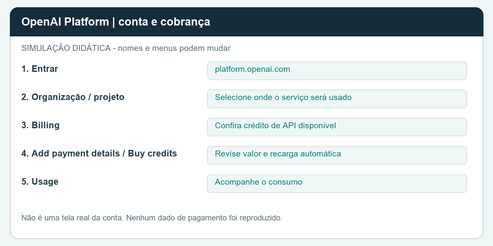

Simulação de navegação. Consulte Billing na organização correta.

1. Abra https://platform.openai.com e entre ou crie sua conta. Conclua as verificações solicitadas.
2. Selecione a organização e o projeto que serão usados pelo serviço da sua calculadora. Anote o nome, sem publicar dados da conta. [S2]
3. Abra a seção Billing. Confira se há crédito de API utilizável ou benefício elegível já vinculado à organização. A assinatura do aplicativo ChatGPT não configura isso automaticamente. [S1]
4. Se necessário, adicione a forma de pagamento e compre créditos. Confira valor, moeda, impostos e a opção Use auto-reload antes de confirmar. Deixe recarga automática desligada se não desejar compras futuras automáticas. [S3]
5. Aguarde o saldo aparecer na mesma organização. Depois acompanhe Usage e os controles de cobrança disponíveis. Um limite de recarga não é um teto instantâneo de uso. [S3]

> **Você pode já ter saldo**
>
> Não compre novamente só porque o aparelho deu erro. Primeiro confira organização, saldo, chave e serviço. Há erros de Wi-Fi e configuração que não são resolvidos com mais crédito.

Links oficiais: platform.openai.com e help.openai.com. Não é necessário assinar o aplicativo de conversa apenas para seguir este fluxo de API.


<a id="pagina-23"></a>

## 23. OpenAI: crie e proteja a chave

*21 | PASSO A PASSO OPENAI - 2/3*

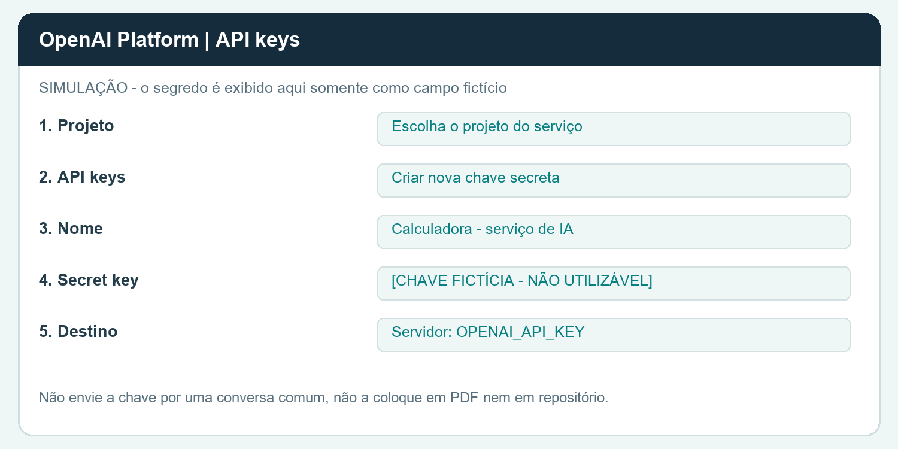

Simulação da criação de chave. A permissão para criar chaves depende do papel da sua conta.

1. No projeto correto, abra API keys. Use a ação de criar uma nova chave secreta; o nome exato do botão pode variar.
2. Dê um nome identificável, como Calculadora - serviço de IA. Escolha as permissões necessárias ao servidor; ele precisa chamar a API de respostas com texto e imagens. [S2, S4]
3. Copie a chave quando for mostrada e guarde-a em um gerenciador de segredos. Se perder o segredo, crie outra chave; não conte com recuperar o valor completo depois. [S2]
4. Instale a chave no servidor conforme a página 24. Para uma instância compartilhada/administrada pelo fornecedor, combine um canal seguro ou faça você mesmo o cadastro do segredo.
5. Se a chave vazar, revogue-a na plataforma, crie outra e atualize o servidor. Remover o texto de um arquivo público não revoga uma chave já exposta. [S2]

> **Não cole aqui no aparelho**
>
> A caixa Chave de acesso da calculadora não recebe a chave OpenAI. Essa separação permite substituir a chave do provedor sem regravar cada calculadora.

A escolha do modelo fica no serviço, não na criação da chave. Nesta edição, o principal é GPT-6.1 Terra. A página 27 explica o modo econômico e o custo.


<a id="pagina-24"></a>

## 24. Ative o serviço e faça o teste

*22 | PASSO A PASSO OPENAI - 3/3*

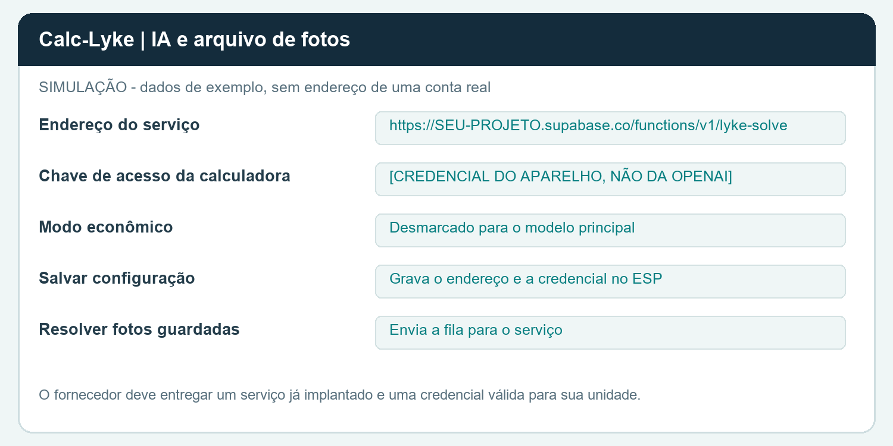

Simulação do formulário real. Não há campo de seleção OpenAI/Claude na R9a.

### Se o serviço já está pronto

1. Abra http://192.168.8.1 conectado a Calc-Lyke. Na seção IA e arquivo de fotos, confira o Endereço do serviço fornecido.
2. Se for configurar/substituir o acesso, informe a Chave de acesso da calculadora entregue pelo administrador. Escolha se deseja Modo econômico e toque em Salvar configuração.
3. Conecte a calculadora à internet. Fotografe uma folha com 2*x+3=11. Confira a foto e envie uma vez. Verifique se a resposta encontra x=4 e confere a substituição. Essa consulta usa a API e pode ter custo.
4. Confira também Abrir última resposta e o arquivo da consulta. Se não responder, use a página 30 antes de repetir vários envios.

### Se você administra a instância

Primeiro implante a função lyke-solve, as migrações e o bucket privado do projeto. No Supabase do seu projeto, em Edge Functions > Secrets, salve OPENAI_API_KEY. Configure também a credencial própria do aparelho, seu hash no serviço e os recursos de arquivo; uma chave OpenAI sozinha não cria esse servidor. O procedimento técnico e os arquivos de implantação ficam em docs/API-E-ARQUIVO.md e supabase/ no código-fonte. [S7]

> **Verificação final do fornecedor**
>
> Entregue endereço, acesso exclusivo do aparelho, política de crédito/limite, suporte e forma de recuperar fotos. O comprador não precisa receber segredos administrativos do Supabase.


<a id="pagina-25"></a>

## 25. Claude: prepare conta e cobrança

*23 | ALTERNATIVA CLAUDE - 1/2*

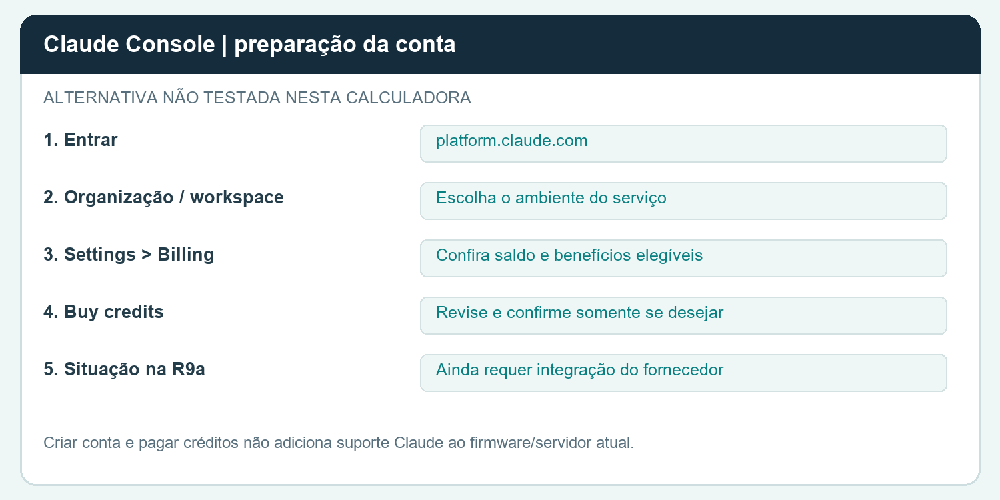

Simulação didática do Console Claude. Não é captura de uma conta real.

> **Só OpenAI foi testada**
>
> O serviço entregue nesta edição chama a OpenAI. Não chama Claude. As etapas abaixo preparam a conta Anthropic para uma futura integração; não constituem ativação pronta na calculadora.

1. Antes de comprar crédito, confirme com o fornecedor se ele disponibilizará um servidor com suporte Claude e quando ele será validado.
2. Abra https://platform.claude.com e entre ou crie uma conta. Selecione a organização/workspace que receberá o serviço. [S5]
3. Abra Settings > Billing, ou https://platform.claude.com/settings/billing. Confira o saldo e eventuais créditos elegíveis vinculados a um plano; não presuma que estar logado no aplicativo Claude já habilitou a API. [S6]
4. Se optar por financiar a API, use Buy credits, confira o valor e confirme o pagamento. A conta precisa ter papel de cobrança adequado. Revise auto-reload para evitar compras automáticas indesejadas. [S6]

Mantenha o serviço OpenAI funcionando até a alternativa estar implementada e testada. Os nomes e a localização dos menus do Console podem mudar; os links oficiais de referência estão ao final deste manual.


<a id="pagina-26"></a>

## 26. Claude: chave e o que falta ativar

*24 | ALTERNATIVA CLAUDE - 2/2*

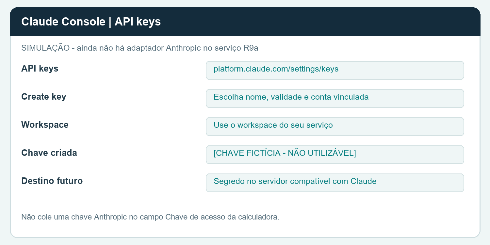

Simulação da criação de chave Claude. Somente a integração OpenAI foi testada.

1. Abra https://platform.claude.com/settings/keys. Clique em Create key. Informe nome e validade; escolha a conta vinculada e o workspace adequado. Para um serviço compartilhado, o administrador pode usar uma conta de serviço. [S5]
2. Copie o segredo quando ele for mostrado e guarde-o com segurança. A chave completa só aparece na criação; se perder, crie outra. Não a inclua em PDF, GitHub ou capturas de tela. [S5]
3. Peça ao fornecedor uma versão do servidor que aceite Anthropic Messages, envie os JPEGs ao modelo de visão escolhido e normalize a resposta para o protocolo da calculadora. É uma implementação necessária, não uma configuração disponível nesta R9a. [S9]
4. Somente depois dessa implementação, instale o segredo no servidor, configure o endereço/credencial de serviço apropriados no aparelho e repita os testes de foto, resposta curta, paginação e arquivo privado.
5. Considere Claude disponível apenas quando esse teste passar na sua unidade. Até lá, use a integração OpenAI validada.

> **Trocar apenas a chave não funciona**
>
> As APIs têm formatos diferentes. Não substitua OPENAI_API_KEY por uma chave sk-ant-... e não altere só o nome do modelo. A preferência por Claude exige o adaptador e sua validação, que não foram feitos nesta edição.


<a id="pagina-27"></a>

## 27. Modelos, custos e uso econômico

*25 | CUIDE DO CONSUMO*

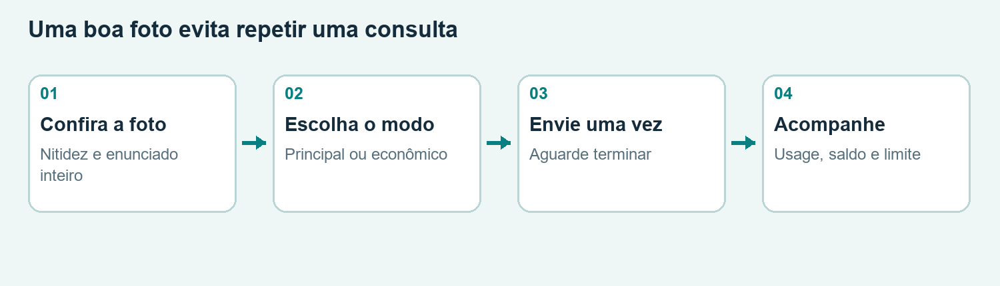

Fluxo de uso. Capturar e baixar localmente não chama a API; enviar para resolver chama.

| Modo atual | O que o serviço usa |
| --- | --- |
| Principal | GPT-6.1 Terra, com raciocínio alto. |
| Modo econômico | GPT-6 Luna, com raciocínio médio. |
| Onde mudar | Portal > IA e arquivo de fotos > Modo econômico > Salvar configuração. |
| Quem define outros modelos | Administrador do servidor, após verificar disponibilidade e compatibilidade. |

A preferência inicial por “6.2 Terra” resultou em GPT-6.1 Terra, modelo Terra disponível no catálogo consultado. O serviço mantém esse identificador; o nome não muda automaticamente quando surgem versões novas. A disponibilidade deve ser conferida na plataforma. [S10]

O custo depende de modelo, imagens e tokens de entrada/saída. Não há preço fixo por exercício nem quantidade garantida de questões por compra de crédito. Consulte o preço e o consumo atuais na plataforma antes de definir seu orçamento. [S11]

A configuração inicial do serviço limita novas consultas a 50 em uma janela móvel de 24 horas por aparelho; o administrador pode ajustar. Esse limite é do projeto, separado do saldo e dos limites da OpenAI. Reenvios da mesma consulta concluída podem recuperar o resultado em cache, mas uma nova consulta pode cobrar novamente.

> **Evite repetir por impaciência**
>
> Se AGUARDANDO IA aparecer, aguarde. Em caso de erro, confira a mensagem antes de reenviar. O saldo pré-pago e os avisos de orçamento não devem ser tratados como corte instantâneo garantido de gastos. [S3]


<a id="pagina-28"></a>

## 28. Desligar, despertar e preservar dados

*26 | ENERGIA E MEMÓRIA*

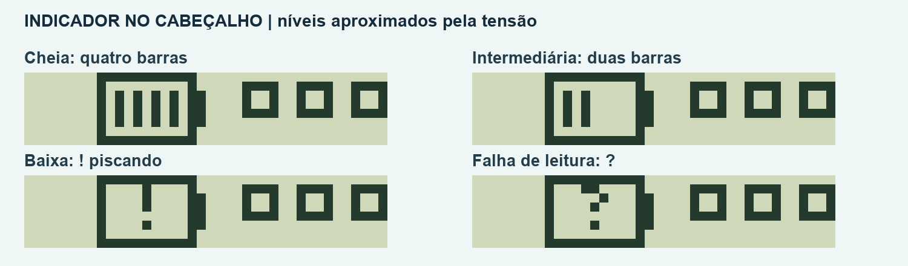

Simulações do código real: o ícone fica antes dos três quadrados de fotos, na mesma janela visível.

| Ação / dado | O que acontece |
| --- | --- |
| MODE > DESLIGAR WIFI | Desliga o Wi-Fi do ESP nesta sessão. O cálculo local continua. |
| SHIFT, AC | Limpa a entrada, apaga a tela e pede Wi-Fi desligado. MODE desperta a tela. |
| Reabrir o portal | MODE > CONFIG. CELULAR (ou VER FOTOS NO WIFI) solicita o portal novamente. |
| Reiniciar / chave física | Ao reiniciar o ESP, Calc-Lyke volta a abrir automaticamente. |
| Bateria no cabeçalho | Quatro níveis aproximados; ! pisca abaixo de cerca de 3,45 V. ? indica leitura inválida. |
| MODE > BATERIA | Mostra a tensão aproximada; = mede de novo. A leitura automática é renovada a cada 30 segundos. |

### O que permanece ao desligar

Permanecem o mapeamento de teclas, as preferências salvas, o programa salvo, as redes cadastradas, a configuração do serviço e a última resposta gravada no ESP. O arquivo do servidor também permanece conforme a política do serviço.

### O que se perde

Perdem-se a entrada atual, Ans, memórias A-F/X/Y/M/Δ/θ/Ω, histórico, estatística, pilha RPN e fotos ainda na fila temporária. Antes de cortar energia, conclua o envio ou baixe as imagens e pare qualquer atualização em andamento.

> **Alimentação e recarga**
>
> Use apenas o conector, a fonte e o procedimento entregues para sua unidade. As barras estimam a carga pela tensão; não são uma porcentagem exata nem indicam carregamento. A montagem de referência usa uma célula e divisor de 470 kΩ + 470 kΩ corrigido e conferido pelo proprietário. Para recarregar, siga a orientação específica da unidade; não use o ícone para decidir qual entrada alimentar.


<a id="pagina-29"></a>

## 29. Atualize somente com o arquivo correto

*27 | MANUTENÇÃO PELO WI-FI*

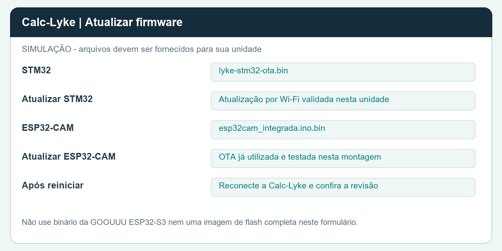

Simulação da seção de atualização. Há dois processadores e arquivos diferentes.

1. Solicite ao fornecedor o arquivo para o processador e a versão exatos de sua calculadora. Confirme o nome e, se fornecido, o hash do arquivo.
2. Mantenha alimentação estável e salve as fotos pendentes. A atualização pode reiniciar o aparelho e apagar a fila temporária.
3. Abra MODE > ATUALIZAR FIRMWARE. No celular, conecte em Calc-Lyke e acesse http://192.168.8.1.
4. Na seção Atualizar firmware, escolha o arquivo na linha correta: STM32 ou ESP32-CAM. Use o botão correspondente uma vez.
5. Aguarde a conclusão sem desligar nem trocar de rede. Após o reinício, reconecte o celular ao portal e confira a revisão e uma conta simples. O AP volta a abrir no boot do ESP.

> **Não desligue ao chegar a 100%**
>
> A barra mede o envio ao ESP. Depois ainda há verificação e gravação. Aguarde a mensagem STM32 atualizado e reiniciado. A base V2 já está instalada nesta unidade; as próximas atualizações do STM dispensam abrir a carcaça ou acessar o USB.

A identificação de 49 teclas no portal deve aparecer com o teclado concluído quando ESP e STM32 estão funcionando juntos. Em falha de atualização, anote a mensagem e procure suporte antes de tentar arquivos de outro hardware.


<a id="pagina-30"></a>

## 30. Se algo não funcionar

*28 | SOLUÇÃO DE PROBLEMAS*

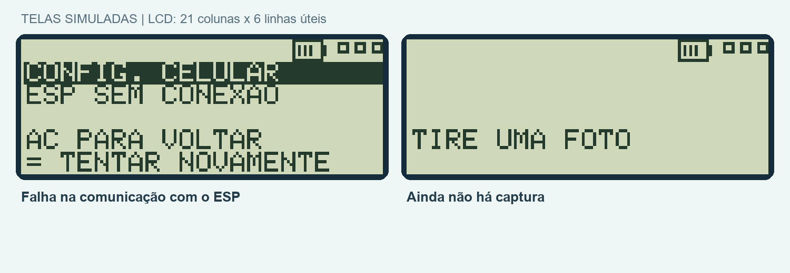

Simulações de mensagens. Anote o texto exato para o suporte.

| Sintoma | O que tentar |
| --- | --- |
| Tela apagada | Pressione MODE uma vez. Confira a chave física e a alimentação fornecida. |
| ON não liga | É esperado: ON não está mapeada. Use a chave física; MODE desperta tela apagada. |
| Calc-Lyke sumiu | Reabra CONFIG. CELULAR. Se necessário, reinicie fora de captura/envio/atualização; fotos da fila serão perdidas. |
| 192.168.8.1 não abre | Confirme conexão a Calc-Lyke, mantenha rede sem internet e use http://, não https://. |
| Wi-Fi externo não conecta | Confira rede 2,4 GHz, senha e status no portal. Cadastre de novo se a senha mudou. |
| ESP SEM CONEXAO | Pressione = para tentar. Se persistir, confira energia e procure suporte da montagem. |
| ESP OCUPADO / AGUARDANDO IA | Aguarde a operação atual. Evite várias confirmações de envio. |
| TIRE UMA FOTO | Capture ao menos uma foto antes de enviar. A fila pode ter sido limpa ou perdida no reinício. |
| Chave de acesso inválida | Confira a credencial do aparelho e o endereço do serviço com o administrador. |
| Sem crédito / limite diário | Confira Billing da API ou a janela de limite do serviço. Comprar crédito não remove o limite local. |
| Foto ruim / resposta inventada | Abra o JPEG, confira enquadramento, nitidez e dados transcritos; refaça a questão completa. |
| SEM RESPOSTA SALVA | Ainda não há resposta disponível. Faça uma consulta válida e aguarde a conclusão. |

Em erro matemático, confira parênteses, domínio, DEG/RAD e ENTRADA ALGEBRICA/RPN. Se aparecer MEMORIAS LIMPAS, a sequência SHIFT, MODE foi acionada; não é restauração de fábrica.


<a id="pagina-31"></a>

## 31. Todos os itens do menu

*29 | CONSULTA RÁPIDA*

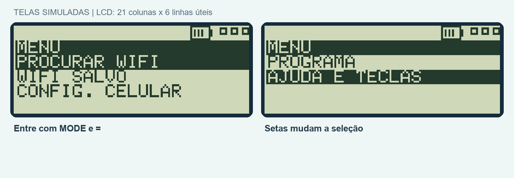

Simulações. A seleção percorre as opções e retorna ao início ao passar do fim.

| Item do menu | Função |
| --- | --- |
| PROCURAR WIFI | Lista redes externas; cadastro de senha pelo celular. |
| WIFI SALVO | Escolhe uma rede já cadastrada e solicita a conexão. |
| CONFIG. CELULAR | Abre/reabre o portal local Calc-Lyke. |
| TIRAR FOTO | Captura um JPEG para a fila temporária. |
| ENVIAR FOTOS IA | Abre confirmação; = envia 1 a 3 fotos. |
| ULTIMA RESPOSTA | Abre o texto salvo com paginação pelas setas. |
| VER FOTOS NO WIFI | Orienta acesso ao portal e à galeria local. |
| REMOVER ULT. FOTO | Descarta a foto mais recente da fila. |
| LIMPAR FOTOS | Descarta todas as fotos da fila. |
| ATUALIZAR FIRMWARE | Abre o acesso ao portal de atualização. |
| DESLIGAR WIFI | Desliga o rádio na sessão atual; reboot reativa AP. |
| BATERIA | Consulta tensão aproximada em PA0. |
| MODO CIENTIFICO | Ângulo, formato/precisão e entrada ALG/RPN. |
| ESTATISTICA | Médias, desvios, somas e regressão. |
| CONSTANTES | Insere uma das seis constantes. |
| PROGRAMA | Grava, executa ou apaga uma sequência de teclas. |
| AJUDA E TECLAS | Mostra lembretes de operação em três páginas. |


<a id="pagina-32"></a>

## 32. Teclas: funções científicas

*30 | REFERÊNCIA COMPLETA - 1/2*

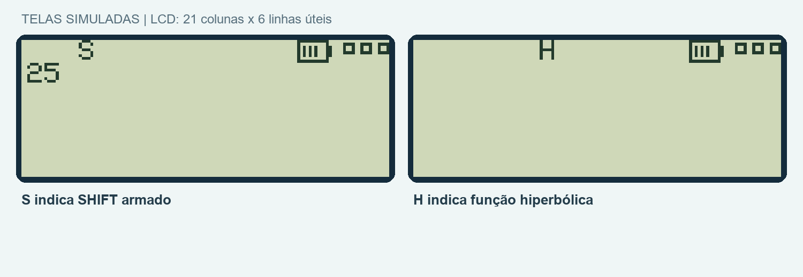

Simulações. Pressione e solte SHIFT antes da tecla; hyp permanece armado até a função trigonométrica.

| Tecla | Sem SHIFT | Depois de SHIFT |
| --- | --- | --- |
| x^-1 | Recíproco | Fatorial ! |
| nCr | Combinação | Arranjo nPr |
| Pol( | Pol(x,y) | Rec(r,ângulo) |
| x^3 | Cubo | Raiz cúbica cbrt( |
| ab/c | Divisão fracionária; após = alterna fração | Alterna apresentação fracionária |
| sqrt | Raiz quadrada | Mesma raiz quadrada |
| x^2 | Quadrado | Mesmo quadrado |
| ^ | Potência | Raiz de índice n |
| log | Logaritmo base 10 | 10^( |
| ln | Logaritmo natural | exp( |
| (-) | Sinal de menos | Mesmo sinal |
| DMS | Entrada DMS; após = alterna exibição | Alterna exibição decimal/DMS |
| hyp | Arma/desarma H | Também arma/desarma H |
| sin / cos / tan | Trigonométricas; com H, hiperbólicas | Inversas; com H, inversas hiperbólicas |
| EXP | Notação E; se vazio, começa por 1E | Constante pi |
| Ans | Último resultado | Alterna DEG / RAD / GRA |

ALPHA, ln insere a constante e. ALPHA,^ insere Δ; ALPHA,log insere θ; ALPHA,EXP insere Ω. São variáveis numéricas, assim como A-F/X/Y/M (página 11). O texto e os atalhos deste guia prevalecem sobre legendas secundárias herdadas da carcaça original.


<a id="pagina-33"></a>

## 33. Teclas: edição, memória e controle

*31 | REFERÊNCIA COMPLETA - 2/2*

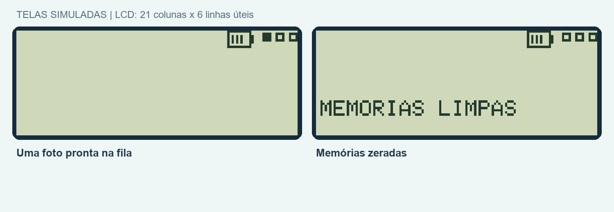

Simulações. Limpar memórias e apagar fotos são comandos diferentes.

| Tecla | Função principal / secundária |
| --- | --- |
| 0 a 9 | Algarismos. SHIFT, 0: Rnd(. SHIFT, 1: SOMA X. SHIFT, 2: MEDIA X. SHIFT nos demais: mesmo algarismo. |
| Ponto . | Decimal. SHIFT, ponto: Ran# pseudoaleatório. |
| + / - / x / / | Operações aritméticas; SHIFT mantém a operação. |
| ( e ) | Parênteses; SHIFT mantém o símbolo. |
| Vírgula , | Separa valores. SHIFT, vírgula: registra dado/par estatístico. |
| RCL | Recupera variável. SHIFT, RCL: STO (guardar). Depois escolha a tecla da variável. |
| M+ | Soma valor à memória M. SHIFT, M+: subtrai de M. |
| ENG | Alterna ENG/NORM, com ou sem SHIFT. |
| = | Calcula; em RPN, empilha/ENTER. SHIFT, =: %. |
| DEL | Apaga elemento; após resultado, recupera conta. SHIFT, DEL: inserir/sobrescrever. |
| AC | Limpa entrada; em menus, volta. SHIFT, AC: tela apagada e Wi-Fi OFF. |
| MODE | Abre menu; sai de subpágina. SHIFT, MODE: zera memórias locais. |
| REPLAY esquerda/direita | Move cursor. SHIFT, direita, na conta: captura foto. |
| REPLAY cima/baixo | Histórico de expressões. Em menus e respostas, navega. |
| SHIFT / ALPHA | Arma/desarma modificador para próxima tecla; um cancela o outro. |
| ON | Sem função nesta unidade. Ligue pela chave física. |

> **Atalhos valem na tela de cálculo**
>
> Dentro dos menus, as teclas seguem as regras de navegação. Para usar SHIFT, direita ou outra função de cálculo, volte primeiro com AC.


<a id="pagina-34"></a>

## 34. Aprenda com uma IA usando o .md

*32 | MATERIAL PARA CONTINUAR*

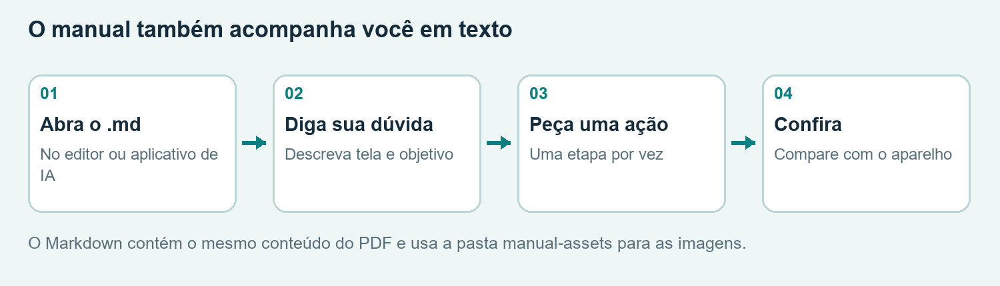

Fluxo de aprendizado. Nunca envie chaves, senhas ou dados de pagamento para obter ajuda.

### Copie este pedido para começar

> **Prompt de aprendizagem**
>
> Estou usando a Lyke modificada com STM32 R12 e ESP R9a. Use o manual anexado como referência. Sou iniciante: explique uma ação por vez, diga exatamente qual tecla pressionar e o que devo ver. Diferencie captura, envio à IA e arquivo. Se a função não existir nesta versão, diga isso. Minha dúvida é: [descreva].

### O que anexar

Anexe Manual-Lyke.md ao chat e, se houver suporte a imagens, uma foto da tela ou a figura pertinente do pacote. Explique em que passo parou e transcreva a mensagem. Para manter as figuras ao abrir o Markdown localmente, deixe manual-assets na mesma pasta do .md; o ZIP já tem essa estrutura.

| Termo | Significado simples |
| --- | --- |
| Firmware | Programa instalado dentro da calculadora. |
| API | Forma de o servidor conversar com o provedor de IA. |
| Portal / AP | Página local e rede Calc-Lyke que permitem configurar. |
| Servidor / serviço | Sistema na internet que chama a IA e guarda o arquivo. |
| RAM / arquivo privado | Memória temporária do aparelho / armazenamento com acesso controlado. |
| Token / credencial | Segredo que identifica o acesso do aparelho ao serviço. |

Para suporte, informe revisão, mensagem, quantidade de fotos, status de rede e sequência de teclas. Não publique o segredo do aparelho ou da OpenAI. A IA ajuda a entender o manual; a confirmação do resultado deve vir da tela e dos testes da sua unidade.


<a id="pagina-35"></a>

## 35. Compatibilidade e entrega da unidade

*33 | O QUE FOI VALIDADO*

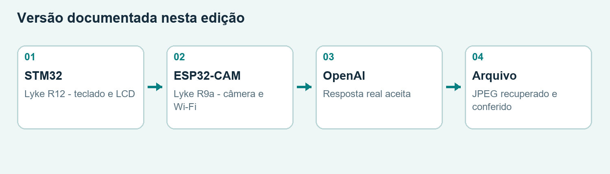

Estado do projeto em 24/11/2026. Esquema, implementação e teste físico são coisas diferentes.

| Situação | Evidência ou limite |
| --- | --- |
| Testado: OpenAI e arquivo | Consulta de visão com equação sintética 2*x+3=11 retornou x=4; reenvio em cache conferido. |
| Testado: envio pelo ESP | Captura real da bancada enviada pelo próprio ESP, arquivada e respondida pela IA; JPEG recuperado com hash idêntico. |
| Testado: AP e OTA do ESP | Portal automático, desligamento por comando, retorno após reinício e atualização ESP por Wi-Fi. |
| Testado: atualização e LCD | STM R12 e ESP R9a instalados pelo Wi-Fi; revisões e mapa de 49 teclas conferidos. Raiz/frações confirmadas anteriormente pelo usuário. |
| Bateria e resolução completa | Dois resistores de 470 kΩ corrigidos pelo proprietário; leitura normal. API v2 conferida com três fotos de questão real e desenvolvimento completo. |
| Limites de validação | Figuras: testes locais do renderizador aprovados; geração real pelo modelo ainda não testada no aparelho. Claude não integrado/testado. |

### Checklist para receber a calculadora pronta

1. Peça a demonstração de ligar/desligar, fazer 2+3x4 e ler a tela na sua unidade.
2. Confira senha do AP, orientação da câmera, alimentação/recarga e uma foto legível de questão real.
3. Peça uma resolução completa no LCD e o procedimento de recuperar/excluir fotos do serviço.
4. Confirme quem paga a API, os limites, contato de suporte e arquivos corretos de atualização.

Este manual não é o manual original de fábrica da Lyke. A carcaça foi adaptada e a eletrônica é do projeto CAMERA_ESP. A ilustração da frente e as telas são simulações; há também uma foto real da unidade, enviada pelo proprietário, na página de fontes.


<a id="pagina-36"></a>

## 36. Fontes, imagens e versão

*34 | REFERÊNCIAS*

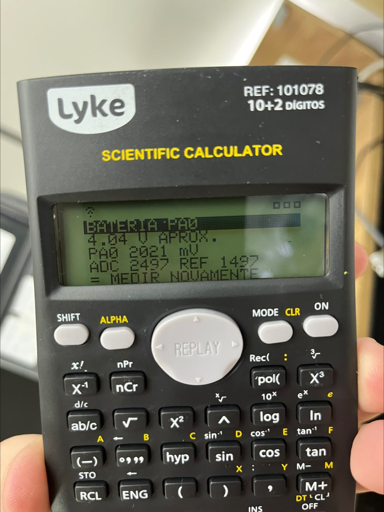

Foto real da unidade modificada durante o ajuste da bateria, anterior ao ícone R11. As demais telas são simulações; o produto comercial original está em [S12].

Links oficiais consultados em 23/11/2026. As telas de portais deste manual são desenhos explicativos: menus e condições comerciais podem mudar. As instruções de operação local foram conferidas nos fontes R12/R9a.

| Referência | Documento oficial |
| --- | --- |
| S1 | [OpenAI: cobrança ChatGPT e plataforma API](https://help.openai.com/en/articles/9039756-managing-billing-for-chatgpt-and-the-api-platform) |
| S2 | [OpenAI: chaves de API e contas de serviço](https://developers.openai.com/api/docs/guides/api-keys) |
| S3 | [OpenAI: crédito pré-pago e recarga](https://help.openai.com/en/articles/8264644-how-can-i-set-up-prepaid-billing) |
| S4 | [OpenAI: início rápido da API](https://developers.openai.com/api/docs/quickstart) |
| S5 | [Claude: criar e administrar chave de API](https://platform.claude.com/docs/en/get-api-key) |
| S6 | [Claude: cobrança e compra de créditos](https://support.claude.com/en/articles/8977456-how-do-i-pay-for-my-claude-api-usage) |
| S7 | [Supabase: segredos de Edge Functions](https://supabase.com/docs/guides/functions/secrets) |
| S8 | [Supabase: controle de acesso ao Storage](https://supabase.com/docs/guides/storage/security/access-control) |
| S9 | [Claude: API e formato de mensagens](https://platform.claude.com/docs/en/api/overview) |
| S10 | [OpenAI: modelo GPT-6.1 Terra](https://developers.openai.com/api/docs/models/gpt-6.1-terra) |
| S11 | [OpenAI: preços atuais da API](https://developers.openai.com/api/docs/pricing) |
| S12 | [Lyke: produto comercial de referência 101078](https://lyke.com.br/produtos/detalhes/calculadora-cientifica-10-2-digitos/) |

Fontes locais: firmware/lyke_stm32/interface.h e scientific.h; firmware/esp32cam_integrada/lyke/portal.h; supabase/functions/lyke-solve/; docs/API-E-ARQUIVO.md e docs/conhecimento/. As telas usam a fonte bitmap Adafruit GFX, licença BSD incluída no pacote como FONT-LICENSE.txt. Ilustrações, diagramação e simulações produzidas para este guia.

## Contexto estruturado para uma IA de apoio

```yaml
produto: Lyke 101078 modificada
data_manual: 2026-11-24
stm32: lyke-r12
esp: lyke-r9a
esp_chip: ESP32 clássico AI Thinker, 4 MB flash e 4 MB PSRAM
nao_confundir: GOOUUU ESP32-S3 + DevKit (montagem diferente)
teclas: 49; ON não mapeada
lcd: janela 126x48; 21 colunas x 6 linhas úteis; resposta em 6 linhas sem ícones
ap: Calc-Lyke
portal: http://192.168.8.1
wifi_boot: AP sempre abre; OFF só na sessão
captura: SHIFT e depois direita, na tela de cálculo
fotos: 1 a 3 JPEGs em RAM; até 512 KiB cada
envio: MODE > ENVIAR FOTOS IA > confirmar com =
arquivo: só após envio, no serviço privado
bateria: 0-4 barras aproximadas; ! baixa; ? leitura inválida; medição a cada 30 s
stm_ota: Wi-Fi do ESP + UART existente; base V2 já instalada e testada
api_testada: OpenAI Responses; figuras da API v3 ainda sem teste real no aparelho
leitor: texto e desenhos 2D; cima/baixo 16px; lados 24px em figura larga ou 48px verticais em texto
wifi_indicador: 3 pulsos no sucesso, depois oculto; falha alterna Wi-Fi/X
modelo_principal: gpt-6.1-terra / high
modelo_economico: gpt-6-luna / medium
claude: não integrado e não testado; exige adaptador Anthropic no servidor
segredo_openai: só no servidor, OPENAI_API_KEY
credencial_aparelho: diferente da chave OpenAI
hardware_final: posição de chave, câmera, carregador e bateria depende da unidade
nao_inventar: testes físicos, menu Claude, galeria histórica no portal, recarga e pinagem
```

Para ajudar o comprador, use primeiro os procedimentos deste manual, peça a mensagem exata e oriente uma etapa por vez. Não peça que publique chaves/senhas. Não trate compra de créditos como solução para toda falha. Não mande abrir, refazer fios ou gravar imagem de outro hardware para um problema de uso.
